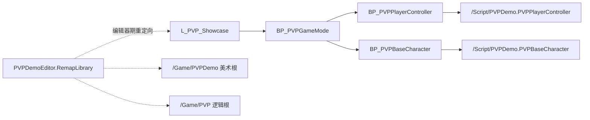

## 产品概述

在 UE5 第一人称 PVP 工程中补齐"游戏框架层"，并把第三方演示关卡转为工程自有、可独立运行的地图。规范以根目录 `AGENTS.md`（上下文入口 + 硬约束）与 `Docs/`（Source-Structure / Content-Structure / AI-Workflow）为唯一来源。

## 核心功能

- 游戏模式与玩家控制器：新增自有 C++ 类，游戏模式指定默认 Pawn 与玩家控制器并输出可核对日志；控制器负责光标与输入模式默认值、记录实际附身 Pawn、提供"获取当前角色"只读接口；输入绑定本次不实现，只留明确待办位。
- 蓝图资产：生成游戏模式蓝图（默认 Pawn 指向 `BP_PVPBaseCharacter`、控制器指向控制器蓝图）与玩家控制器蓝图；既有 `BP_PVPBaseCharacter` 仅迁移位置，父类与内容不变。
- 资产归位：美术资产留在 `Content/PVPDemo/`，蓝图、地图、接口、数据资产迁入新的 `Content/PVP/`，迁移后旧路径不残留重定向器。
- 地图复制与接入：复制演示关卡为新地图；新地图内不保留任何第三方角色实例，原角色位置改为出生点，玩家由新游戏模式按 `BP_PVPBaseCharacter` 生成；其余第三方逻辑对象全部保留，数量与布局不变，仅类引用改指向自有副本。
- 去除第三方依赖：自有美术根、逻辑根与新地图内部不再出现任何第三方包引用；缺失的接口、后处理动画、备用骨骼网格与逻辑蓝图按类型补入对应根。
- 源关卡零改动：执行前后源地图与构建数据文件指纹必须完全一致。
- 验收与文档同步：独立脚本从磁盘重新加载并断言引用计数、包路径、父类、默认 Pawn/控制器、地图游戏模式、出生点、Actor 数量守恒与源关卡指纹，失败即非零退出并落盘报告；按 `Docs/AI-Workflow.md` 第 3 节清单同步全部文档。

## 视觉与体验效果

打开新地图直接 Play 即进入第一人称视角，玩家由新游戏模式生成的 `BP_PVPBaseCharacter` 接管，出生位置与朝向和原演示关卡中的角色一致。场景外观与源关卡保持一致：地面、墙面、立柱、轮胎与箱体道具、天空盒、施工灯与灯光氛围全部保留，演示信息板与武器配置对象仍在场景中且可正常加载；不再出现第三方角色，也不会因第三方包缺失出现缺失引用警告或贴图丢失。

## 规范基线与偏离声明

规范来源：`AGENTS.md` 第 1 至 5 节 + `Docs/Source-Structure.md`、`Docs/Content-Structure.md`、`Docs/AI-Workflow.md`；`.codebuddy/rules/doc-first/RULE.mdc` 仅做入口导航，不写正文。

拟偏离 Docs 的 3 条（已获用户确认，执行前先在文档登记再落地）：

1. 偏离 `AGENTS.md` 第 4.2 条"源码只能落 Character/Camera/Animation/Equipment/Input/GAS，不新建未登记顶层目录"：新增 `Source/PVPDemo/Game/` 分层与 `Source/PVPDemoEditor/` 编辑器模块。理由：GameMode/PlayerController 属会话与玩家入口，不属既有任何层；资产重定向需 `UnrealEd/AssetTools`，不能进运行时模块。
2. 偏离第 4.5 条"资产只放 `Content/PVPDemo/<模块>/` 且只放美术（唯一例外 `BP_PVPBaseCharacter`）"：新增逻辑资产根 `Content/PVP/`，并取消该例外（蓝图迁出后 `Content/PVPDemo` 回归纯美术）。理由：逻辑资产混在美术根违反模块语义。
3. 偏离 `migrate_pvp_assets.py` 既定"只迁美术、排除逻辑资产"策略：允许复制必要的第三方逻辑蓝图与接口作为自有副本。理由：要求新地图不依赖第三方包，且类引用必须指向自有副本。

非偏离但需写入文档：第 4.7 条要求新增模块时同步 Build.cs，本次新增的是独立编辑器模块并自带 Build.cs；运行时 `PVPDemo.Build.cs` 不改（`AGameModeBase`/`APlayerController` 属 Engine），该结论写入 Source-Structure。

## 技术栈

- 引擎 UE 5.9（`D:/UE/UE_5.9/UE_5.9`），工程 `D:/UE/Unreal Projects/PVPDemo`，运行时模块 `PVPDemo`，导出宏 `PVPDEMO_API`。
- 新增编辑器模块 `PVPDemoEditor`（Type Editor、LoadingPhase PostEngineInit，`.uproject` 登记），依赖 Core / CoreUObject / Engine / UnrealEd / AssetTools / AssetRegistry / Projects。
- 资产自动化：Unreal Python headless（`UnrealEditor-Cmd.exe -run=PythonScript -Script=<abs> -unattended -nosplash -nullrhi`），沿用 `Content/Python/` 既有脚本风格。
- 引用重定向：`ObjectTools::ForceReplaceReferences(TArrayView&lt;FReplaceRequest&gt;, TSet&lt;UObject*&gt;&amp;)`（`Engine/Source/Editor/UnrealEd/Public/ObjectTools.h:426-434`，`UNREALED_API`）；Python 无对应 API，由编辑器模块暴露 `UFUNCTION(BlueprintCallable)` 入口。
- include 根为 `Source/`（`PVPDemo.Shared.rsp` 实证），新文件写法 `#include "PVPDemo/Game/PVPGameMode.h"` 与既有 Character 层一致。

## 实现方案

### 1. C++ 层

- `APVPGameMode : AGameModeBase`：构造设 `PlayerControllerClass`、`DefaultPawnClass = APVPBaseCharacter::StaticClass()`、`bStartPlayersAsSpectators = false`；不硬编码蓝图路径，由 `BP_PVPGameMode` 的 CDO 覆盖为 `BP_PVPBaseCharacter`；覆写 `InitGame`/`StartPlay` 仅 `Super` + 一条日志。
- `APVPPlayerController : APlayerController`：构造 `bShowMouseCursor = false`；`BeginPlay` 设 `FInputModeGameOnly` 并打日志；`SetupInputComponent` 仅 `Super` + `TODO(Input)`；`OnPossess` 打印 Pawn 类名与包路径；`GetPVPCharacter()` 为 `BlueprintPure` 的 `Cast&lt;APVPBaseCharacter&gt;(GetPawn())`。
- 日志类别只在 `.cpp` 用 `DEFINE_LOG_CATEGORY_STATIC`；头文件仅类声明，角色类用前置声明。

### 2. 编辑器重定向工具

`UPVPAssetRemapLibrary` 入参：旧包路径数组、新包路径数组（一一对应）、扫描前缀数组（`/Game/PVPDemo`、`/Game/PVP`）、报告路径。实现：按映射加载对象构造 `FReplaceRequest`，用 AssetRegistry 枚举扫描前缀下资产并加载收集 `ObjectsToReplaceWithin`，调用 `ForceReplaceReferences`，标脏并保存包，写报告（替换条数、未命中映射、失败包）。全程不写 `Content/InfimaGames/`。

### 3. 零依赖收敛（fixpoint，上限 6 轮）

种子映射 = `migration_manifest.json` 的 576 条 + 3 个资源副本 + 本次新建蓝图。每轮：重定向 → 磁盘扫描残留 `/Game/InfimaGames/` → 对残留目标"复制 → TFA 改 PVP 前缀 → 按类型落根" → 进入下一轮。落根规则：蓝图/动画蓝图/接口/数据资产/关卡 → `/Game/PVP/<模块>`；网格/贴图/材质/骨架/物理资产/动画/特效/音频 → `/Game/PVPDemo/<模块>`；模块目录优先沿用 manifest 的 `target_folder`。零残留成功；一轮无新增映射且仍有残留即失败并出报告。

### 4. 资产与地图流水线（幂等）

1. 引用审计通过后 `rename_asset` 迁移 `BP_PVPBaseCharacter` 至 `/Game/PVP/Characters/`，保存重载二次校验，清理残留重定向器并断言旧包不存在。
2. `BlueprintFactory` 建 `BP_PVPGameMode`、`BP_PVPPlayerController`；对前者 CDO 设 `default_pawn_class`（迁移后的生成类对象）与 `player_controller_class`，编译并保存。
3. `duplicate_asset` 复制源地图为 `/Game/PVP/Maps/L_PVP_Showcase`；不复制 `_BuiltData`（工程 `r.AllowStaticLighting=False`）；复制前记录源 `.umap`/`_BuiltData` 的 SHA256。
4. 加载新地图：仅销毁第三方角色实例并缓存其世界变换，在该变换生成 `PlayerStart`；其余 Actor 一律不销毁。
5. 放置实例的类引用替换统一交给收敛重定向（整份蓝图副本保证实例属性与组件结构一致）。
6. `WorldSettings.set_editor_property('default_game_mode', BP_PVPGameMode)` 后 `save_map`。
7. 回退策略：4 个动画通知蓝图对 `BP_TFA_BaseCharacter` 的引用优先重定向到 `BP_PVPBaseCharacter`；编译失败才复制 `BP_PVP_LegacyCharacter` 到 `/Game/PVP/Actors/` 仅作类引用目标、不入关卡，回退原因写报告与文档。

### 5. 验收矩阵（硬断言，失败即非零退出）

| 断言 | 口径 |
| --- | --- |
| 零第三方引用 | `Content/PVP`、`Content/PVPDemo`、`L_PVP_Showcase.umap` 二进制 `/Game/InfimaGames/` 计数 = 0，白名单为空 |
| 蓝图位置/父类 | `BP_PVPBaseCharacter` 在 `/Game/PVP/Characters/`，父类 `/Script/PVPDemo.PVPBaseCharacter`；旧路径无资产无 redirector |
| GameMode 默认类 | CDO `default_pawn_class` 在 `/Game/PVP/Characters/`，`player_controller_class` 在 `/Game/PVP/Game/` |
| 地图接入 | GameMode Override = `BP_PVPGameMode_C`；`PlayerStart` 数量至少 1 |
| 角色实例 | 新地图内 `BP_TFA_BaseCharacter_C` 与 `BP_PVP_LegacyCharacter_C` 实例数均为 0 |
| 场景守恒 | 新地图 Actor 数 = 源地图 Actor 数（移除 1 角色实例 + 新增 1 出生点） |
| 源关卡只读 | 源 `.umap` 与 `_BuiltData` SHA256 与执行前一致 |


### 6. 架构与依赖方向



模块：`PVPDemo`（Runtime，`Game → Character` 单向；同模块内为约定约束，UBT 无法编译期强制）+ `PVPDemoEditor`（Editor，仅编辑器期，不进入打包）。两个自有资产根与新地图不得再引用 `/Game/InfimaGames`。

## 文档同步（按 AI-Workflow 第 3 节逐项）

- `AGENTS.md`：第 1 节速览（Game 层、编辑器模块、自有资产两根、第三方包不再被依赖）；第 2 节文档地图（加 setup/verify 脚本、`Content/PVP` 维度、`Saved/PVPGameFrameworkReport/` 产物行）；第 4.2 条层清单加 `Game/`；第 4.5 条改两根并删除"唯一例外"表述；第 4.6 条脚本登记。
- `Docs/Source-Structure.md`：第 1 节目录树加 `Game/`；第 2 节新增 `Game/` 层职责表与 `PVPDemoEditor` 模块小节；文首"当前状态/阶段说明"改为已落地；第 3 节根目录文件表补编辑器模块 Build.cs；第 4 节补依赖方向、"分层仅约定"与"运行时模块无新增依赖"结论；第 5 节两根关系。
- `Docs/Content-Structure.md`：文首来源说明改"已自包含、原包仅开发期参考"，资产总数按实测；第 1 节目录树加 `Content/PVP` 与各模块数量；第 2 节补 `BP_`、`L_` 前缀；新增 `Content/PVP` 章节；第 3.2 节删除"逻辑资产例外"块；第 4 节表格加映射行；第 5.1 与 5.7 改写；补脚本登记与打包 Cook 注意事项。
- `README.md`：顶层目录块补 `Content/PVP/`、`Source/PVPDemo/Game`、`Source/PVPDemoEditor`；「关于第三方资产」段改为已自包含。
- `.codebuddy/rules/doc-first/RULE.mdc`：仅改第 2 节速查中过期两行（层清单加 `Game/`、资产两根），保持导航定位。
- `Docs/AI-Workflow.md`：本次流程未变化，不改。
- `Content/Python/compare_tfa_character.py`：派生蓝图路径改 `/Game/PVP/Characters` 并同步 docstring。
- 每次回复末尾输出「文档同步」小节（AGENTS.md 第 5 节 / AI-Workflow 第 4 节）。

## 执行注意

- 前置条件：用户在编辑器内保存全部改动并关闭，确认 `UnrealEditor.exe` 退出；构建 `Build.bat PVPDemoEditor Win64 Development -Project="D:/UE/Unreal Projects/PVPDemo/PVPDemo.uproject" -WaitMutex`。
- 顺序不可颠倒：登记文档 → 编译 → 迁移/建蓝图 → 复制地图并移除角色实例 → 收敛重定向 → 校验 → 收尾同步。
- 风险：300 余 `.uasset` 会被重写，git diff 很大；建议先做基线快照（未获用户明确同意不得 commit）。类替换后对 `AN/ANS_PVP_*`、`AM_PVP_*_Heal_Syringe` 逐个编译，失败即回退该条映射并记录。
- 不动对象：`PVPDemo.Build.cs`、`Config/DefaultEngine.ini`、`Content/InfimaGames/`、`BP_PVPBaseCharacter` 内容、源地图文件。
- 性能：重定向按包批量加载保存，一次性离线批处理；轮间 `CollectGarbage`；收敛上限 6 轮防死循环。

## 目录结构

```
PVPDemo/
├── AGENTS.md                                  # [MODIFY] 第 1 节速览、第 2 节文档地图、第 4.2/4.5/4.6 条硬约束
├── Source/
│   ├── PVPDemo/
│   │   ├── Game/PVPGameMode.h|.cpp            # [NEW] APVPGameMode：默认类、InitGame/StartPlay 日志，日志类别在 .cpp
│   │   ├── Game/PVPPlayerController.h|.cpp    # [NEW] APVPPlayerController 骨架：GameOnly、OnPossess 日志、GetPVPCharacter
│   │   ├── Character/PVPBaseCharacter.h|.cpp  # [不改动] 既有 1P 角色
│   │   └── PVPDemo.Build.cs                   # [不改动] 无新增依赖，结论写入文档
│   └── PVPDemoEditor/
│       ├── PVPDemoEditor.Build.cs             # [NEW] Editor 模块依赖：UnrealEd/AssetTools/AssetRegistry/Projects
│       ├── PVPDemoEditor.h|.cpp               # [NEW] IMPLEMENT_MODULE(FDefaultModuleImpl, PVPDemoEditor)
│       └── PVPAssetRemapLibrary.h|.cpp        # [NEW] ForceReplaceReferences 批量重定向 + 报告
├── Content/
│   ├── Python/
│   │   ├── setup_pvp_game_framework.py        # [NEW] 迁移蓝图、建两份蓝图、复制地图、移除角色实例+出生点、收敛重定向、报告
│   │   ├── verify_pvp_game_framework.py       # [NEW] 零依赖/路径/哈希/Actor 数/角色实例断言
│   │   └── compare_tfa_character.py           # [MODIFY] 派生蓝图路径改 /Game/PVP/Characters 并同步 docstring
│   ├── PVP/
│   │   ├── Characters/BP_PVPBaseCharacter.uasset       # [MOVE] 自 Content/PVPDemo/Characters 迁入
│   │   ├── Characters/BPI_PVP_AnimationState.uasset    # [NEW] 接口副本
│   │   ├── Characters/ABP_PVP_Manny_PostProcess.uasset # [NEW] 后处理动画副本
│   │   ├── Game/BP_PVPGameMode.uasset                  # [NEW] Pawn=BP_PVPBaseCharacter，Controller=BP_PVPPlayerController
│   │   ├── Game/BP_PVPPlayerController.uasset          # [NEW] 父类 APVPPlayerController
│   │   ├── Actors/                                     # [NEW] 收敛补齐的逻辑副本（墙体/灯具/信息板/配置/武器/注射器 BP、DA_PVP_AssaultRifle、可选 BP_PVP_LegacyCharacter）
│   │   └── Maps/L_PVP_Showcase.umap                    # [NEW] 无第三方角色实例，新增出生点，其余 Actor 全保留，GameMode 覆盖
│   └── PVPDemo/                               # [MODIFY] 357 个资产引用改为自有副本；新增 SKM_PVP_Quinn 美术副本
├── Docs/Source-Structure.md                   # [MODIFY] Game 层、编辑器模块、状态、依赖与两根关系
├── Docs/Content-Structure.md                  # [MODIFY] Content/PVP 章节、前缀、数量、自包含结论、脚本登记
├── README.md                                  # [MODIFY] 顶层目录与第三方资产说明
├── .codebuddy/rules/doc-first/RULE.mdc         # [MODIFY] 仅第 2 节速查两行
└── PVPDemo.uproject                           # [MODIFY] 增加 PVPDemoEditor 模块条目
```

## 关键代码结构

```cpp
// Source/PVPDemo/Game/PVPGameMode.h
UCLASS(Blueprintable)
class PVPDEMO_API APVPGameMode : public AGameModeBase
{
    GENERATED_BODY()
public:
    APVPGameMode();
    virtual void InitGame(const FString&amp; MapName, const FString&amp; Options, FString&amp; ErrorMessage) override;
    virtual void StartPlay() override;
};

// Source/PVPDemo/Game/PVPPlayerController.h
UCLASS(Blueprintable)
class PVPDEMO_API APVPPlayerController : public APlayerController
{
    GENERATED_BODY()
public:
    APVPPlayerController();
    virtual void BeginPlay() override;
    virtual void SetupInputComponent() override;
    virtual void OnPossess(APawn* InPawn) override;

    UFUNCTION(BlueprintPure, Category = "PVP|Pawn")
    APVPBaseCharacter* GetPVPCharacter() const;
};

// Source/PVPDemoEditor/PVPAssetRemapLibrary.h
UFUNCTION(BlueprintCallable, Category = "PVP|Tools")
static bool RemapAssetReferences(const TArray&lt;FString&gt;&amp; InFromPackages,
                                 const TArray&lt;FString&gt;&amp; InToPackages,
                                 const TArray&lt;FString&gt;&amp; InPackagesToScan,
                                 const FString&amp; InReportPath);
```

## Agent Extensions

### Skill

- **UE5架构规划师**
- Purpose: 校验新增 `Game/` 运行时层与 `PVPDemoEditor` 编辑器模块的归属、Build.cs 依赖最小集与 `Game → Character` 单向边界；按技能要求把包路径迁移与资产重定向作为升级人工处理项，产出引用审计结论。
- Expected outcome: 模块职责与依赖方向表、运行时 Build.cs 无需改动的结论、编辑器模块依赖清单与审计要点，写入 AGENTS.md 与 Docs/Source-Structure.md。
- **虚幻引擎Claude Code技能**
- Purpose: 约束新增 C++ 代码符合 Epic 编码与反射规范（UCLASS/GENERATED_BODY、include 顺序、日志类别仅 .cpp、构造内设 CDO 默认值、前置声明、不硬编码蓝图路径）。
- Expected outcome: 六个源文件通过 UBT 编译，运行时与编辑器模块零错误。
- **UE Python Scripting**
- Purpose: 编写 headless 幂等脚本，覆盖资产迁移、蓝图创建与 CDO 设值、地图复制与"仅移除角色实例 + 新增出生点"、收敛式重定向调用、磁盘零依赖与源图哈希校验。
- Expected outcome: setup 与 verify 脚本无人值守执行成功，报告全 PASS 且退出码为 0，源关卡哈希与执行前一致。