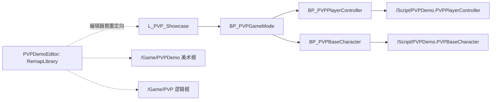

## 产品概述

在现有 UE5 第一人称 PVP 工程中补齐“游戏框架层”，并把第三方演示关卡转为工程自有、可独立运行的地图。

## 核心功能

- **游戏模式**：新增自有游戏模式，指定默认 Pawn、玩家控制器与默认 GameState/PlayerState/HUD；对局初始化与开场输出可核对日志，为后续对局流程预留扩展位但不实现。
- **玩家控制器**：新增自有控制器骨架，设置光标与输入模式默认值、记录实际附身的 Pawn 类型、提供“获取当前角色”的只读接口；本次不接入输入绑定，仅保留明确待办位。
- **蓝图资产**：生成游戏模式蓝图（默认 Pawn 指向 `BP_PVPBaseCharacter`、控制器指向玩家控制器蓝图）与玩家控制器蓝图；既有 `BP_PVPBaseCharacter` 仅迁移位置，父类与内容不变。
- **资产归位**：美术资产与逻辑资产（蓝图、地图、接口、数据资产）分根存放，逻辑资产不再混入美术目录；迁移后旧路径不留重定向器。
- **地图复制与接入**：复制演示关卡为新地图；**新地图内不保留任何第三方角色实例**，原角色所在位置改为出生点，玩家由新游戏模式按 `BP_PVPBaseCharacter` 生成并接管；其余 Actor 全部保留，数量与布局不变，仅其类引用改指向工程自有副本。
- **去除第三方依赖**：工程自有美术根、逻辑根与新地图内部不再出现任何第三方包引用；缺失的接口、后处理动画、备用骨骼网格与逻辑蓝图副本按类型补入对应根目录。
- **源关卡零改动**：源关卡在两个时间点的文件指纹必须完全一致，全程只读。
- **验收与规范同步**：独立脚本从磁盘重新加载并断言引用计数、包路径、父类、默认 Pawn/控制器、地图游戏模式、出生点数量、Actor 数量守恒与源关卡指纹，失败即非零退出并落盘报告；文档与项目规则按实测结果更新。

## 视觉与体验效果

打开新地图直接 Play 即进入第一人称视角，玩家由新游戏模式生成的 `BP_PVPBaseCharacter` 接管，出生位置与朝向和原演示关卡中的角色一致。场景外观与源关卡保持一致：地面、墙面、立柱、轮胎与箱体道具、天空盒、施工灯与灯光氛围全部保留；演示信息板与武器配置对象仍留在场景中且可正常加载。新地图不再出现第三方角色，也不会因第三方包缺失产生缺失引用警告或贴图丢失。

## 现状与规范基线（已核实）

- 引擎 UE 5.9（`D:/UE/UE_5.9/UE_5.9`），工程 `D:/UE/Unreal Projects/PVPDemo`，运行时模块 `PVPDemo`，导出宏 `PVPDEMO_API`；`PVPDemo.uproject` 当前仅登记 1 个模块。
- include 根为 `Source/`（`Intermediate/.../PVPDemo.Shared.rsp` 实证），故 `#include "PVPDemo/Game/PVPGameMode.h"` 与既有 `Character/` 写法一致。
- 规范唯一来源已改为 `AGENTS.md` + `Docs/`；`.codebuddy/rules/doc-first/RULE.mdc` 只做导航，**不再承载规范正文**（上一版计划中“修订 RULE 的层清单/两根规则”的写法作废）。
- 源地图非 World Partition、无 PlayerStart、无 GameMode Override，直接引用 35 个第三方路径（24 条美术有副本、10 条逻辑无副本，另有地图自身与 `_BuiltData`）。
- `Content/PVPDemo` 中 357 个资产、1531 条 `/Game/InfimaGames/` 引用；1514 条可由 `Saved/MigrationReports/migration_manifest.json`（576 条 TFA→PVP 映射）覆盖；8 个目标无副本：`BP_TFA_BaseCharacter`、`BP_TFA_BaseWeapon`、`BP_TFA_Syringe`、`BP_TFA_PhysicsSyringe`、`BP_TFA_PhysicsSyringeCap`、`BPI_TFA_AnimationState`、`SKM_Quinn`、`ABP_Manny_PostProcess`。
- `Content/PVP` 尚不存在；`Content/PVPDemo/Characters/BP_PVPBaseCharacter.uasset` 父类 `/Script/PVPDemo.PVPBaseCharacter`，复用不重建；`Content/InfimaGames/` 只读且被 git 忽略。
- 编辑器当前在运行（DLL 占用/资产双写风险），编译与命令行建资产前必须由用户保存并关闭。

## 拟偏离 Docs 的 3 条（均已获用户确认，实施时先登记再落地）

1. 偏离 `AGENTS.md` §4.2「源码只能落 `Character/ Camera/ Animation/ Equipment/ Input/ GAS/`，不新建未登记顶层目录」：新增 `Source/PVPDemo/Game/` 与编辑器模块 `Source/PVPDemoEditor/`。理由：GameMode/PlayerController 属会话与玩家入口，不属既有任何层；重定向工具依赖编辑器专用模块 `UnrealEd/AssetTools`，不能进运行时模块。
2. 偏离 §4.5「资产只放 `Content/PVPDemo/<模块>/`」：新增逻辑资产根 `Content/PVP/`（`Characters/`、`Game/`、`Maps/`、`Actors/`），`Content/PVPDemo` 回归纯美术。理由：`.uasset` 逻辑资产（蓝图/地图/接口/数据资产）混在美术根违反模块语义，且已在上一轮由用户裁决。
3. 偏离 `migrate_pvp_assets.py` 既定策略「只迁移美术、排除逻辑资产」：本次允许复制必要的第三方逻辑蓝图与接口作为自有副本。理由：用户要求新地图不依赖第三方包且不删除第三方逻辑 Actor，类引用必须指向自有副本。

## 技术栈

- 运行时：UE C++（UCLASS 反射）+ UBT；`AGameModeBase` / `APlayerController` 均属 Engine，`PVPDemo.Build.cs` **不改**。
- 编辑器：新增 `PVPDemoEditor`（`Type: Editor`、`LoadingPhase: PostEngineInit`，`.uproject` 登记），依赖 `Core / CoreUObject / Engine / UnrealEd / AssetTools / AssetRegistry / Projects`。
- 资产自动化：Unreal Python headless（`UnrealEditor-Cmd.exe <uproject> -run=PythonScript -Script=<abs> -unattended -nosplash -nullrhi`），沿用 `Content/Python/` 既有脚本风格（`log()` + 绝对资产路径 + 报告落盘 + 失败抛异常）。
- 引用重定向：`ObjectTools::ForceReplaceReferences(TArrayView<FReplaceRequest>, TSet<UObject*>&)`（`Engine/Source/Editor/UnrealEd/Public/ObjectTools.h:426-434`，`UNREALED_API`）。UnrealPython 无对应 API，必须由编辑器模块暴露 `UFUNCTION(BlueprintCallable)`。

## 架构与依赖方向



- 模块：`PVPDemo`（Runtime，`Game → Character` 单向；同模块内为约定约束，UBT 无法编译期强制）+ `PVPDemoEditor`（Editor，仅编辑器期，不进入打包）。
- 资产：美术 → `/Game/PVPDemo/<模块>`；逻辑 → `/Game/PVP/{Characters,Game,Maps,Actors}`；两根本身及新地图不得再引用 `/Game/InfimaGames`。

## C++ 设计

- `APVPGameMode : AGameModeBase`：构造设 `PlayerControllerClass = APVPPlayerController::StaticClass()`、`DefaultPawnClass = APVPBaseCharacter::StaticClass()`、`bStartPlayersAsSpectators = false`；**不硬编码蓝图路径**，由 `BP_PVPGameMode` 的 CDO 覆盖为 `BP_PVPBaseCharacter`。覆写 `InitGame` / `StartPlay` 仅 `Super` + 一条日志。
- `APVPPlayerController : APlayerController`：构造 `bShowMouseCursor = false`；`BeginPlay` 设 `FInputModeGameOnly` + 日志；`SetupInputComponent` 仅 `Super` + `// TODO(Input)`；`OnPossess` 打印 Pawn 类名与包路径；`GetPVPCharacter()` 为 `BlueprintPure` 的 `Cast<APVPBaseCharacter>(GetPawn())`。
- 日志类别只在 `.cpp` 顶部 `DEFINE_LOG_CATEGORY_STATIC`；头文件只放声明，`APVPBaseCharacter` 前置声明。

## 编辑器重定向工具

```cpp
UCLASS()
class UPVPAssetRemapLibrary : public UBlueprintFunctionLibrary
{
    GENERATED_BODY()
public:
    // 一一对应的旧/新包路径，只在前缀命中的包内替换，最后写报告
    UFUNCTION(BlueprintCallable, Category = "PVP|Tools")
    static bool RemapAssetReferences(const TArray<FString>& InFromPackages,
                                     const TArray<FString>& InToPackages,
                                     const TArray<FString>& InPackagesToScan,
                                     const FString& InReportPath);
};
```

实现要点：按映射 `LoadObject` 构造 `FReplaceRequest` 数组 → 用 AssetRegistry 枚举 `InPackagesToScan` 前缀下的资产并加载，收集 `ObjectsToReplaceWithin` → `ObjectTools::ForceReplaceReferences(Requests, Within)` → `MarkPackageDirty` + `UEditorLoadingAndSavingUtils::SavePackages` → 写报告（替换条数、未命中映射、失败包）。全程不写 `Content/InfimaGames/`。

## 零依赖收敛（fixpoint，≤6 轮）

1. 种子映射 = manifest 576 条 + 3 个资源副本（`BPI_PVP_AnimationState`、`ABP_PVP_Manny_PostProcess`、`SKM_PVP_Quinn`）+ 本次新建蓝图。
2. 每轮：重定向 `/Game/PVPDemo`、`/Game/PVP` → 磁盘扫描残留 `/Game/InfimaGames/` → 对每个残留目标“复制 → TFA→PVP 改名 → 按类型落根” → 加入映射进入下一轮。
3. 落根规则：`Blueprint / AnimBlueprint / BlueprintInterface / DataAsset / World` → `/Game/PVP/<模块>`；`SkeletalMesh / StaticMesh / Texture / Material / Skeleton / PhysicsAsset / AnimSequence / AnimMontage / Niagara / Sound` → `/Game/PVPDemo/<模块>`；模块目录优先沿用 manifest 的 `target_folder`。
4. 终止：残留为 0 成功；一轮内无新增映射且仍有残留 → 失败、出报告、非零退出。
5. 复杂度：每轮 O(包数) 加载 + O(引用数) 替换，1531 条引用规模下单轮秒级；轮间 `CollectGarbage`，避免多轮内存累积。

## 地图流水线（保留式，仅移除角色实例）

1. `rename_asset` 迁移 `BP_PVPBaseCharacter` → `/Game/PVP/Characters/`；保存、重载二次校验、清理残留重定向器，断言旧包不存在。
2. `BlueprintFactory` 建 `BP_PVPGameMode` / `BP_PVPPlayerController`；`BP_PVPGameMode` 的 CDO 设 `default_pawn_class`（迁移后的生成类对象）与 `player_controller_class`，编译并保存。
3. `duplicate_asset` 复制源地图为 `/Game/PVP/Maps/L_PVP_Showcase`；**不复制 `_BuiltData`**（工程 `r.AllowStaticLighting=False`）。复制前记录源 `.umap`/`_BuiltData` 的 SHA256。
4. 加载新地图：枚举 Actor，**仅销毁第三方角色实例**（类包路径以 `/Game/InfimaGames` 开头且为 `BP_TFA_BaseCharacter_C`），缓存其世界变换并在该变换生成 `PlayerStart`；其余 Actor 一律不销毁。
5. 放置实例的类引用替换统一交给收敛重定向（整份蓝图副本保证实例属性/组件结构一致，避免逐 Actor 改类丢数据）。
6. `WorldSettings.set_editor_property('default_game_mode', BP_PVPGameMode 生成类)` → `save_map`。
7. 回退策略：`BP_TFA_BaseCharacter` 仍被 4 个已迁移通知蓝图引用，优先重定向到 `BP_PVPBaseCharacter`；若这 4 个蓝图编译失败，则复制 `BP_PVP_LegacyCharacter` 到 `/Game/PVP/Actors/` **仅作类引用目标，不放入任何关卡**，回退原因写入报告与文档。

## 验收矩阵（全部硬断言，失败即非零退出）

| 断言 | 口径 |
| --- | --- |
| 零第三方引用 | `Content/PVP`、`Content/PVPDemo`、`L_PVP_Showcase.umap` 二进制 `/Game/InfimaGames/` 计数 = 0，白名单为空 |
| 蓝图位置/父类 | `BP_PVPBaseCharacter` 在 `/Game/PVP/Characters/`，父类 `/Script/PVPDemo.PVPBaseCharacter`；旧路径无资产、无 redirector |
| GameMode 默认类 | CDO `default_pawn_class` 包路径在 `/Game/PVP/Characters/`，`player_controller_class` 在 `/Game/PVP/Game/` |
| 地图接入 | GameMode Override = `BP_PVPGameMode_C`；`PlayerStart` ≥ 1 |
| 角色实例 | 新地图内 `BP_TFA_BaseCharacter_C` 与 `BP_PVP_LegacyCharacter_C` 实例数均为 0 |
| 场景守恒 | 新地图 Actor 数 = 源地图 Actor 数（移除 1 个角色实例 + 新增 1 个 PlayerStart） |
| 源关卡只读 | 源 `.umap` 与 `_BuiltData` SHA256 与执行前一致 |


## 执行注意事项

- **前置条件**：用户在编辑器内保存全部改动并关闭，确认 `UnrealEditor.exe` 退出后再编译；构建命令 `Build.bat PVPDemoEditor Win64 Development -Project="D:/UE/Unreal Projects/PVPDemo/PVPDemo.uproject" -WaitMutex`。
- **顺序不可颠倒**：登记文档 → 编译 → 迁移/建蓝图 → 复制地图并移除角色实例 → 收敛重定向 → 校验 → 收尾同步。
- **风险**：300 余 `.uasset` 会被重写，git diff 很大；建议先做基线快照（**需用户明确同意才能 commit**）。类替换后对 `AN/ANS_PVP_*`、`AM_PVP_*_Heal_Syringe` 逐个编译，失败即回退该条映射并记录。
- **不动的对象**：`PVPDemo.Build.cs`、`Config/DefaultEngine.ini`、`Content/InfimaGames/`、`BP_PVPBaseCharacter` 内容、源地图文件。

## 目录结构

```
PVPDemo/
├── AGENTS.md                                 # [MODIFY] §1 速览、§2 文档地图（新增 setup/verify 脚本与 Content/PVP 维度）、§4 硬约束（层清单加 Game/、资产位置改两根、例外清单）
├── Source/
│   ├── PVPDemo/
│   │   ├── Game/PVPGameMode.h|.cpp           # [NEW] APVPGameMode：默认类、InitGame/StartPlay 日志，日志类别在 .cpp
│   │   ├── Game/PVPPlayerController.h|.cpp   # [NEW] APVPPlayerController 骨架：GameOnly、OnPossess 日志、GetPVPCharacter
│   │   ├── Character/PVPBaseCharacter.h|.cpp # [不改动] 既有 1P 角色
│   │   └── PVPDemo.Build.cs                  # [不改动] 无新增依赖
│   └── PVPDemoEditor/
│       ├── PVPDemoEditor.Build.cs            # [NEW] Editor 模块：UnrealEd/AssetTools/AssetRegistry/Projects
│       ├── PVPDemoEditor.h|.cpp              # [NEW] IMPLEMENT_MODULE(FDefaultModuleImpl, PVPDemoEditor)
│       └── PVPAssetRemapLibrary.h|.cpp       # [NEW] ForceReplaceReferences 批量重定向 + 报告
├── Content/
│   ├── Python/
│   │   ├── setup_pvp_game_framework.py       # [NEW] 迁移蓝图、建两份蓝图、复制地图、移除角色实例+PlayerStart、记录源图哈希、收敛重定向、报告
│   │   ├── verify_pvp_game_framework.py      # [NEW] 零依赖/路径/哈希/Actor 数/角色实例断言，失败非零退出
│   │   └── compare_tfa_character.py          # [MODIFY] 派生蓝图路径改为 /Game/PVP/Characters 并同步 docstring
│   ├── PVP/                                  # [NEW] 逻辑资产根
│   │   ├── Characters/BP_PVPBaseCharacter.uasset      # [MOVE] 自 Content/PVPDemo/Characters 迁入
│   │   ├── Characters/BPI_PVP_AnimationState.uasset   # [NEW] 接口副本
│   │   ├── Characters/ABP_PVP_Manny_PostProcess.uasset# [NEW] 后处理动画副本
│   │   ├── Game/BP_PVPGameMode.uasset                 # [NEW] Pawn=BP_PVPBaseCharacter，Controller=BP_PVPPlayerController
│   │   ├── Game/BP_PVPPlayerController.uasset         # [NEW] 父类 APVPPlayerController
│   │   ├── Actors/                                    # [NEW] 收敛循环补齐的逻辑副本（墙体/灯具/信息板/配置/武器/注射器 BP、DA_PVP_AssaultRifle、可选 BP_PVP_LegacyCharacter 仅作引用目标）
│   │   └── Maps/L_PVP_Showcase.umap                   # [NEW] 源关卡副本：无第三方角色实例，新增 PlayerStart，其余 Actor 全保留，GameMode 覆盖
│   └── PVPDemo/                              # [MODIFY] 357 个资产引用改为自有副本；新增 SKM_PVP_Quinn 美术副本
├── Docs/Content-Structure.md                 # [MODIFY] Content/PVP 章节、前缀 BP_/L_、实测数量、§5.1 自包含结论、脚本登记、保留式接入与源关卡只读约定、打包注意事项
├── Docs/Source-Structure.md                  # [MODIFY] Game/ 层、PVPDemoEditor 模块、目录树、分层仅约定说明、第 5 章两根关系
├── Docs/AI-Workflow.md                       # [不改动] 流程未变化
├── README.md                                 # [MODIFY] 顶层目录补 Content/PVP、Source/PVPDemo/Game、Source/PVPDemoEditor
├── .codebuddy/rules/doc-first/RULE.mdc        # [MODIFY] 仅把 §2 速查中过期的“层清单/资产位置”两行与 AGENTS.md 对齐，保持导航定位
└── PVPDemo.uproject                          # [MODIFY] 增加 PVPDemoEditor 模块条目（Type: Editor, PostEngineInit）
```

## 文档与规则同步范围

- `AGENTS.md`：§1 项目速览（新增 Game 层、PVPDemoEditor、Content/PVP 存在性）；§2 文档地图加 `setup/verify` 脚本行与 `Content/PVP` 维度；§4.2 层清单加 `Game/` 与编辑器模块说明、§4.5 资产两根与例外清单、§4.6 脚本登记。
- `Docs/Source-Structure.md`：第 1 节目录树加 `Game/`；第 2 节新增层职责表与 `PVPDemoEditor` 模块表；文首“当前状态/阶段说明”由“空目录”改为已落地；第 4 节依赖方向与“分层仅约定”说明；第 5 节两根关系。
- `Docs/Content-Structure.md`：第 1 节目录树与实测数量、第 2 节补 `BP_`/`L_` 前缀、第 3 节新增 `Content/PVP` 各模块表、文首总数、§5 约定（自包含、源包只读、不复制 `_BuiltData`、保留式接入、打包 Cook 注意事项）、脚本登记。
- `README.md`：顶层目录结构块补 `Content/PVP/`、`Source/PVPDemo/Game`、`Source/PVPDemoEditor`。
- `.codebuddy/rules/doc-first/RULE.mdc`：仅同步 §2 两行速查，不写规范正文。

## Agent Extensions

### Skill

- **UE5架构规划师**
- Purpose: 确定新增 `Game/` 运行时层与 `PVPDemoEditor` 编辑器模块的归属、Build.cs 依赖最小集与 `Game → Character` 单向边界；按技能要求把“包路径迁移 / 资产重定向”作为升级人工处理项，产出引用审计与偏离结论。
- Expected outcome: 模块职责与依赖方向表、`PVPDemo.Build.cs` 无需改动的结论、编辑器模块依赖清单、迁移审计要点，并写入 `AGENTS.md` 与 `Docs/Source-Structure.md`。
- **虚幻引擎Claude Code技能**
- Purpose: 约束新增 C++ 代码符合 UE 编码与反射规范（`UCLASS`/`GENERATED_BODY`、include 顺序、日志类别仅 `.cpp`、构造内设 CDO 默认值、前置声明、不硬编码蓝图路径）。
- Expected outcome: `PVPGameMode`、`PVPPlayerController`、`PVPAssetRemapLibrary` 共 6 个源文件通过 UBT 编译，运行时与编辑器模块零错误。
- **UE Python Scripting**
- Purpose: 编写 headless 幂等脚本，覆盖资产迁移、蓝图创建与 CDO 设值、地图复制与“仅移除角色实例 + 新增 PlayerStart”、收敛式重定向调用、磁盘零依赖与源图哈希校验。
- Expected outcome: `setup_pvp_game_framework.py` 与 `verify_pvp_game_framework.py` 无人值守执行成功，`Saved/PVPGameFrameworkReport/` 报告全 PASS、退出码 0，源关卡哈希与执行前一致。