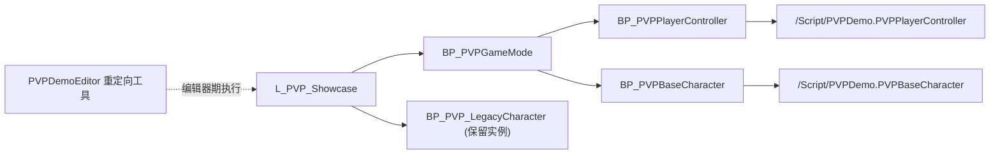

## 用户需求

在现有 UE5 第一人称 PVP 工程中，按 `Docs/` 的分层与命名规范补齐"游戏框架层"，并完成关卡接入与文档同步。共三条要求，逐条叠加：

1. 阅读 Docs 描述，自行编写 C++ 游戏模式类与角色控制器类；在内容目录生成与之对应的蓝图；复制 `L_TFA_AR_Showcase` 生成一张新地图存放在内容目录，把新地图的游戏模式与控制器替换为新产物，并把 Pawn 指定为 `BP_PVPBaseCharacter`；完成后修改对应文档。
2. 新地图中的资产引用必须指向工程内已迁移的副本，不得依赖第三方资源包。
3. **第三方的逻辑 Actor 一个都不能删**；在保证新关卡可用的同时，必须保证原关卡零变化。

## 产品概述

新增"会话与玩家入口"层承载游戏模式与玩家控制器，并产出可直接使用的蓝图资产。把演示关卡复制为工程自有地图：原关卡的场景布局、道具、灯光氛围与全部 Actor 完整保留，只把其类引用替换为工程内的自有副本类；源关卡保持只读，执行前后完全一致。

## 核心功能

- **游戏模式类**：声明默认 Pawn 与玩家控制器、默认 GameState/PlayerState/HUD，输出可核对的初始化与开场日志，为后续对局流程预留扩展位但不实现。
- **玩家控制器类**：设定光标与输入模式默认值、记录实际附身的 Pawn 类型、提供"获取当前角色"的只读接口；本次不接入输入绑定，仅保留明确的待办位置。
- **蓝图资产**：`BP_PVPGameMode`（默认 Pawn 指向 `BP_PVPBaseCharacter`、控制器指向 `BP_PVPPlayerController`）与 `BP_PVPPlayerController`；既有 `BP_PVPBaseCharacter` 迁移到逻辑资产根并保持父类不变，不重建。
- **资产归位**：美术资产与逻辑资产分根存放，逻辑资产不再混入美术目录；迁移后旧路径不留重定向器。
- **地图复制与保留式接入**：新地图独立落盘，Actor 数量与相对布局不变；所有第三方逻辑类的放置实例改为指向自有副本类，实例属性因是同一蓝图的完整副本而保持有效；旧角色实例保留原地但不再自动附身、不参与碰撞；在其原世界变换处新增出生点，玩家由新游戏模式按 `BP_PVPBaseCharacter` 生成并接管；地图内指定新游戏模式。
- **自包含改造**：把自有资产内部指向第三方包的引用全部改为指向自有副本，补齐缺失的接口、后处理动画与备用骨骼网格副本，最终自有美术根、逻辑根与新地图均不含任何第三方包引用。
- **验收与规范同步**：独立脚本从磁盘重新加载并断言引用计数、包路径、父类、默认 Pawn/控制器、地图游戏模式、出生点数量、Actor 数量关系与源地图哈希，失败即非零退出并落盘报告；文档与项目规则按实测数量与真实状态更新。

## 视觉与体验效果

打开新地图直接 Play 即进入第一人称视角，玩家由新游戏模式生成的 `BP_PVPBaseCharacter` 接管，出生位置与朝向和原演示关卡中的角色一致。场景外观与源关卡保持一致：地面、墙面、立柱、轮胎与箱体道具、天空盒、施工灯与原有灯光氛围全部保留；仅用于演示的信息板与武器配置对象仍留在场景中且可正常加载，不再依赖第三方包，也不会出现缺失引用警告或贴图丢失。源关卡在任何时候打开都与改动前完全一致。

## 技术栈

- 引擎：UE 5.9（`D:/UE/UE_5.9/UE_5.9`，由注册表 EngineAssociation GUID 指向，与 `PVPDemo.uproject` 一致）。
- 运行时模块：`PVPDemo`（Runtime，导出宏 `PVPDEMO_API`）；新增 `Game/` 层，基类 `AGameModeBase` / `APlayerController` 均属 Engine 模块，`PVPDemo.Build.cs` 无需改动。
- 编辑器模块（新增）：`PVPDemoEditor`（Type Editor，LoadingPhase `PostEngineInit`），承载资产引用重定向工具；依赖 `Core / CoreUObject / Engine / UnrealEd / AssetTools / AssetRegistry / Projects`。`PVPDemoEditor.Target.cs` 已存在，只需在 `.uproject` 的 Modules 中登记。
- 资产自动化：Unreal Python headless（`UnrealEditor-Cmd.exe -run=PythonScript -Script=... -unattended -nosplash -nullrhi`），沿用 `Content/Python/dump_tfa_character.py`、`compare_tfa_character.py` 的既有写法（`log()` + 绝对资产路径 + 报告落盘 + 失败抛异常）。
- 引用重定向：`ObjectTools::ForceReplaceReferences(TArrayView&lt;FReplaceRequest&gt;, TSet&lt;UObject*&gt;&amp;)`（`Engine/Source/Editor/UnrealEd/Public/ObjectTools.h:426-434`，`UNREALED_API`）。UnrealPython 无对应 API，故由编辑器模块暴露 `UFUNCTION(BlueprintCallable)` 入口。

## 现状核实

- `Source/PVPDemo/` 仅 `Character/PVPBaseCharacter.h|.cpp` 有实现，`Animation/ Camera/ Equipment/ GAS/ Input/` 为空目录；include 根为 `Source/`（`PVPDemo.Shared.rsp` 实证），故 `#include "PVPDemo/Game/PVPGameMode.h"` 与既有写法一致。
- `PVPDemo.uproject` 当前只有 1 个模块；`PVPDemoEditor.Target.cs` 已存在且 `ExtraModuleNames.Add("PVPDemo")`，编辑器模块通过 `.uproject` 登记即可被编辑器目标加载。
- `Content/PVPDemo/Characters/BP_PVPBaseCharacter.uasset` 父类为 `/Script/PVPDemo.PVPBaseCharacter`，必须复用不重建。
- 源地图 `/Game/InfimaGames/.../Demo/Maps/L_TFA_AR_Showcase`：非 World Partition、无 PlayerStart、无 GameMode Override，直接引用 35 个第三方路径（24 条美术有 PVP 副本，10 条逻辑无副本，另有地图自身与 `_BuiltData`）。
- `Content/PVPDemo` 中 357 个资产、1531 条 `/Game/InfimaGames/` 引用；1514 条可由 `Saved/MigrationReports/migration_manifest.json`（576 条 TFA→PVP 映射）覆盖，8 个目标无副本：`BP_TFA_BaseCharacter`、`BP_TFA_BaseWeapon`、`BP_TFA_Syringe`、`BP_TFA_PhysicsSyringe`、`BP_TFA_PhysicsSyringeCap`、`BPI_TFA_AnimationState`、`SKM_Quinn`、`ABP_Manny_PostProcess`。
- `Content/InfimaGames/` 为 git 忽略的只读第三方包；编辑器当前在运行，编译与命令行建资产前须先保存并关闭。

## 实现方案

### 1. 架构登记（先于落地）

按项目规则"新目录/新根必须先登记"：先在 `Docs/Source-Structure.md` 第 1/2 节登记 `Game/` 会话与玩家入口层与 `PVPDemoEditor` 编辑器模块，在 `Docs/Content-Structure.md` 登记 `Content/PVP/` 逻辑资产根，同步修订 `RULE.mdc` 的层清单与美术/逻辑两根规则，之后再写代码与建资产。

### 2. C++ 层

- `APVPGameMode : AGameModeBase`：构造设 `PlayerControllerClass`、`DefaultPawnClass = APVPBaseCharacter::StaticClass()`、`bStartPlayersAsSpectators = false`；不硬编码任何蓝图路径，蓝图 CDO 再覆盖为 `BP_PVPBaseCharacter`。覆写 `InitGame` / `StartPlay` 仅 `Super` + 一条日志。
- `APVPPlayerController : APlayerController`：构造设 `bShowMouseCursor = false`；`BeginPlay` 设 `FInputModeGameOnly` 并打日志；`SetupInputComponent` 仅 `Super` + `TODO(Input)` 注释；`OnPossess` 打印 Pawn 类名与包路径；`GetPVPCharacter()` 为 `BlueprintPure` 的 `Cast&lt;APVPBaseCharacter&gt;(GetPawn())`，头文件前置声明角色类。
- 日志类别只在 `.cpp` 顶部 `DEFINE_LOG_CATEGORY_STATIC`，头文件仅类声明。
- `UPVPAssetRemapLibrary : UBlueprintFunctionLibrary`（编辑器模块）：入参 `from_packages` / `to_packages` / `packages_to_scan` / `report_path`；内部按映射加载对象构造 `FReplaceRequest` 数组，收集扫描范围内全部对象作为 `ObjectsToReplaceWithin`，调用 `ObjectTools::ForceReplaceReferences`，再标脏、保存包并写报告（替换条数、未命中映射、失败包）。只读第三方包。

### 3. 保留式地图流水线（幂等，不删 Actor）

1. 引用审计通过后 `rename_asset` 迁移 `BP_PVPBaseCharacter` 至 `/Game/PVP/Characters/`，保存并重新加载二次校验，清理残留重定向器并断言旧包不存在。
2. `BlueprintFactory` 创建 `BP_PVPGameMode`、`BP_PVPPlayerController`；对 `BP_PVPGameMode` 的 CDO 设 `default_pawn_class`（迁移后的生成类对象）与 `player_controller_class`，编译并保存。
3. `duplicate_asset` 复制源地图为 `/Game/PVP/Maps/L_PVP_Showcase`；不复制 `_BuiltData`（工程 `r.AllowStaticLighting=False`），地图内 `LevelBuildData` 保持只读引用。
4. 加载新地图后：**遍历全部 Actor 不销毁任何一个**；旧角色实例设 `auto_possess_player = Disabled`、`collision_profile_name = NoCollision`，位置朝向保持；在其实例世界变换处生成 `PlayerStart`；`WorldSettings.set_editor_property('default_game_mode', BP_PVPGameMode 生成类)`；保存地图。
5. 放置实例的类引用替换交给收敛式的 `ForceReplaceReferences` 统一处理，避免逐个 Actor 手工改类造成属性丢失。

### 4. 零依赖收敛（fixpoint，≤6 轮）

种子映射 = manifest 的 576 条 + `BPI_PVP_AnimationState`、`ABP_PVP_Manny_PostProcess`、`SKM_PVP_Quinn` 三个副本 + 本次新建蓝图。每轮：调用重定向工具（仅作用于 `/Game/PVPDemo`、`/Game/PVP`）→ 磁盘扫描残留 `/Game/InfimaGames/` → 对每个残留目标"复制资产 → TFA→PVP 改名 → 按类型落根"（Blueprint/AnimBlueprint/BlueprintInterface/DataAsset/World → `/Game/PVP/&lt;模块&gt;`；Mesh/Texture/Material/Skeleton/PhysicsAsset/Anim/Niagara/Sound → `/Game/PVPDemo/&lt;模块&gt;`；模块目录优先沿用 manifest 的 `target_folder`）→ 加入映射进入下一轮。零残留即成功；一轮内无新增映射且仍有残留即失败并输出报告。

### 5. 验收（硬指标）

`Content/PVP`、`Content/PVPDemo`、`L_PVP_Showcase.umap` 二进制中 `/Game/InfimaGames/` 计数均为 0（白名单为空）；`BP_PVPBaseCharacter` 在 `/Game/PVP/Characters/` 且父类正确、旧路径无资产无 redirector；`BP_PVPGameMode` 的 `default_pawn_class` 包路径在 `/Game/PVP/Characters/`、`player_controller_class` 在 `/Game/PVP/Game/`；新地图 GameMode Override 为 `BP_PVPGameMode_C`；`PlayerStart ≥ 1`；新地图 Actor 数 = 源地图 Actor 数 + 1；源地图 `.umap` 与 `_BuiltData` 的 SHA256 与执行前一致。

## 实现说明（执行细节）

- **执行前置条件**：请用户先在编辑器中保存全部改动并关闭，确认 `UnrealEditor.exe` 退出后再编译，否则 DLL 占用与资产双写。构建命令：`D:/UE/UE_5.9/UE_5.9/Engine/Build/BatchFiles/Build.bat PVPDemoEditor Win64 Development -Project="D:/UE/Unreal Projects/PVPDemo/PVPDemo.uproject" -WaitMutex`。
- 顺序不可颠倒：登记文档 → 编译运行时层与编辑器模块 → 迁移/创建蓝图 → 复制地图与占位接入 → 收敛重定向 → 校验 → 收尾同步文档。
- 源关卡保护：脚本对源地图仅做 `load_map`（可选）与 `duplicate_asset`；执行前后落盘源文件哈希与 mtime，verify 断言不变；对 `Content/InfimaGames/` 全程只读。
- 性能：重定向按包批量加载/保存，一次性离线批处理；收敛轮次上限 6 轮防死循环；扫描以字符串级残留检测为主，避免逐资产重复打开。
- 风险控制：300 余个 `.uasset` 会被重写，git diff 很大，建议执行前做基线快照（**需用户明确同意后才可 commit**）；类替换后对受影响的蓝图（`AN/ANS_PVP_*` 与 `AM_PVP_*_Heal_Syringe`）做编译检查，失败即记录并回退该条映射；`BP_PVPBaseCharacter` 不重建，`DefaultEngine.ini` 不改，计数一律以脚本实测写入文档。

## 架构设计

- 模块：`PVPDemo`（Runtime，`Game → Character` 单向，同模块内为约定约束）+ `PVPDemoEditor`（Editor，仅编辑器期工具，不进入打包）。
- 资产链路：`L_PVP_Showcase` → `BP_PVPGameMode` → `BP_PVPPlayerController` + `BP_PVPBaseCharacter` → `/Script/PVPDemo.*`；美术资产全部在 `/Game/PVPDemo`，逻辑资产全部在 `/Game/PVP`。
- 反向依赖禁止：两个自有资产根与新地图不得再引用 `/Game/InfimaGames`；第三方包仅作开发期参考。



## 目录结构

```
PVPDemo/
├── Source/
│   ├── PVPDemo/
│   │   ├── Game/PVPGameMode.h|.cpp           # [NEW] APVPGameMode：默认类、InitGame/StartPlay 日志，日志类别在 .cpp
│   │   ├── Game/PVPPlayerController.h|.cpp   # [NEW] APVPPlayerController 骨架：GameOnly、OnPossess 日志、GetPVPCharacter
│   │   ├── Character/PVPBaseCharacter.h|.cpp # [不改动] 既有 1P 角色
│   │   └── PVPDemo.Build.cs                  # [不改动] 无新增依赖
│   └── PVPDemoEditor/
│       ├── PVPDemoEditor.Build.cs            # [NEW] Editor 模块依赖：UnrealEd/AssetTools/AssetRegistry/Projects
│       ├── PVPDemoEditor.h|.cpp              # [NEW] IMPLEMENT_GAME_MODULE(FDefaultGameModuleImpl, PVPDemoEditor)
│       └── PVPAssetRemapLibrary.h|.cpp       # [NEW] ForceReplaceReferences 批量重定向 + 报告
├── Content/
│   ├── Python/
│   │   ├── setup_pvp_game_framework.py       # [NEW] 迁移蓝图、建两份蓝图、复制地图、保留式接入、收敛重定向、报告
│   │   ├── verify_pvp_game_framework.py      # [NEW] 零依赖/路径/哈希/Actor 数断言，失败非零退出
│   │   └── compare_tfa_character.py          # [MODIFY] 派生蓝图路径改为 /Game/PVP/Characters
│   ├── PVP/
│   │   ├── Characters/BP_PVPBaseCharacter.uasset  # [MOVE] 由 Content/PVPDemo/Characters 迁入
│   │   ├── Characters/BPI_PVP_AnimationState.uasset, ABP_PVP_Manny_PostProcess.uasset  # [NEW] 补齐的接口与后处理动画副本
│   │   ├── Game/BP_PVPGameMode.uasset               # [NEW] Pawn=BP_PVPBaseCharacter，Controller=BP_PVPPlayerController
│   │   ├── Game/BP_PVPPlayerController.uasset      # [NEW] 父类 APVPPlayerController
│   │   ├── Actors/                                # [NEW] 收敛循环补齐的逻辑副本（BP_PVP_LegacyCharacter、BP_PVP_BaseWeapon、注射器系列、墙体/灯具 BP 等）
│   │   └── Maps/L_PVP_Showcase.umap               # [NEW] 源关卡副本，Actor 全保留，仅改类引用 + PlayerStart + GameMode 覆盖
│   └── PVPDemo/                             # [MODIFY] 357 个资产引用改为指向自有副本；新增 SKM_PVP_Quinn 美术副本
├── Docs/Source-Structure.md                  # [MODIFY] Game/ 层、PVPDemoEditor 模块、分层约定、两根关系
├── Docs/Content-Structure.md                 # [MODIFY] Content/PVP 章节、BP_/L_ 前缀、实测数量、自包含结论、脚本登记、保留式接入约定
├── README.md                                 # [MODIFY] 顶层目录补 Content/PVP、Source/PVPDemo/Game、Source/PVPDemoEditor
├── .codebuddy/rules/docs-first/RULE.mdc      # [MODIFY] §1.2 层清单、§2.1/§2.3 两根规则、§4 同步清单
└── PVPDemo.uproject                          # [MODIFY] 增加 PVPDemoEditor 模块条目
```

## 关键代码结构

```cpp
// Source/PVPDemo/Game/PVPGameMode.h
UCLASS(Blueprintable)
class PVPDEMO_API APVPGameMode : public AGameModeBase
{
	GENERATED_BODY()
public:
	APVPGameMode();
	virtual void InitGame(const FString& MapName, const FString& Options, FString& ErrorMessage) override;
	virtual void StartPlay() override;
};

// Source/PVPDemo/Game/PVPPlayerController.h
UCLASS(Blueprintable)
class PVPDEMO_API APVPPlayerController : public APlayerController
{
	GENERATED_BODY()
public:
	APVPPlayerController();
	virtual void BeginPlay() override;
	virtual void SetupInputComponent() override;
	virtual void OnPossess(APawn* InPawn) override;

	UFUNCTION(BlueprintPure, Category = "PVP|Pawn")
	APVPBaseCharacter* GetPVPCharacter() const;
};

// Source/PVPDemoEditor/PVPAssetRemapLibrary.h
UCLASS()
class UPVPAssetRemapLibrary : public UBlueprintFunctionLibrary
{
	GENERATED_BODY()
public:
	UFUNCTION(BlueprintCallable, Category = "PVP|Tools")
	static bool RemapAssetReferences(const TArray&lt;FString&gt;& InFromPackages,
	                                 const TArray&lt;FString&gt;& InToPackages,
	                                 const TArray&lt;FString&gt;& InPackagesToScan,
	                                 const FString& InReportPath);
};
```

## Agent Extensions

### Skill

- **UE5架构规划师**
- Purpose: 确定 `Game/` 运行时层与新增 `PVPDemoEditor` 编辑器模块的归属、`Build.cs` 依赖最小集与 `Game → Character` 单向边界；按技能要求把"包路径迁移 / 资产重定向"作为升级人工处理项，产出引用审计与风险结论。
- Expected outcome: 模块职责与依赖方向表、`PVPDemo.Build.cs` 无需改动的结论、编辑器模块依赖清单、迁移审计报告要点，并写回 `Docs/Source-Structure.md`。
- **虚幻引擎Claude Code技能**
- Purpose: 约束新增 C++ 代码符合 UE 编码与反射规范（`UCLASS`/`GENERATED_BODY`、include 顺序、日志类别仅 `.cpp`、构造内设 CDO 默认值、前置声明、不硬编码蓝图路径）。
- Expected outcome: `PVPGameMode`、`PVPPlayerController`、`PVPAssetRemapLibrary` 共 6 个源文件通过 UBT 编译，编辑器与运行时模块零错误。
- **UE Python Scripting**
- Purpose: 编写 headless 幂等脚本，覆盖资产迁移、蓝图创建与 CDO 设值、地图复制与保留式接入、收敛式重定向调用、磁盘零依赖与源地图哈希校验。
- Expected outcome: `setup_pvp_game_framework.py` 与 `verify_pvp_game_framework.py` 无人值守执行成功，`Saved/PVPGameFrameworkReport/` 下报告全 PASS、退出码 0，且源关卡哈希与执行前一致。