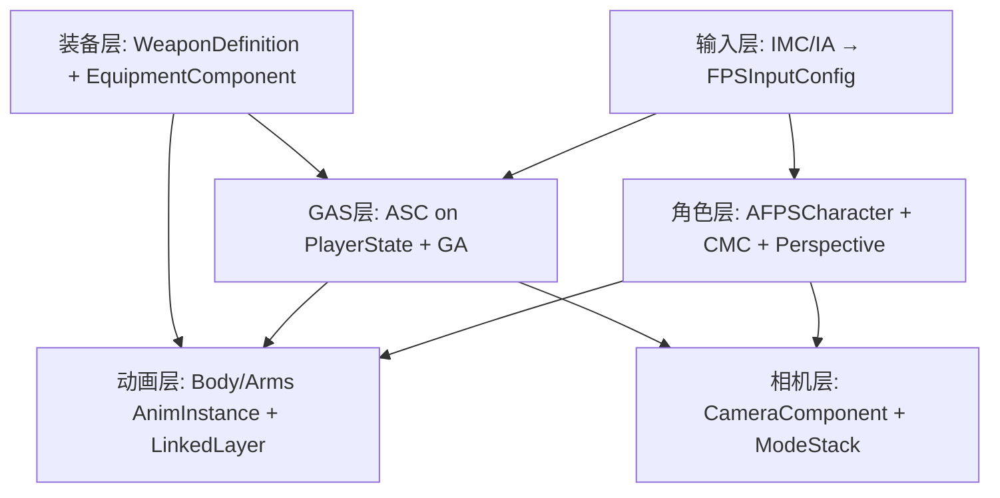

## 产品概述

基于 UE5.9 工程落地一套可扩展、支持多人联机的 FPS 第一人称 3C 系统（Character / Camera / Control），采用双网格 + 相机模式栈 + 武器动画层 + GAS 集成的完整方案。

## 核心功能

- 插件与依赖：启用 Gameplay Abilities、Animation Warping、Animation Budget Allocator（Enhanced Input 已生效），补全 Build.cs 模块依赖与 Config 工程设置
- GAS 基础：从零搭建 ASC（挂 PlayerState）、AbilitySystemGlobals、ActorInfo 网格修正、GameplayTag 配置
- 双网格角色：1P 手臂 + 3P 全身常驻，视角组件统一管理可见性/阴影/Tick 优化，预留可见下半身开关
- 相机模式栈：第一人称/ADS/第三人称/死亡/观战/技能镜头，平滑混合与防穿墙、防穿帮
- 动画系统：双 AnimInstance + Linked Anim Layers 武器动画层 + 程序化第一人称（Sway/Bob/Recoil/ADS 对齐/贴墙收枪）
- 装备系统：武器定义 DataAsset、1P/3P 双武器网格、装备复制与动画层切换
- GAS 技能：开火/瞄准/换弹/冲刺，双网格 Montage 播放与复制，GameplayCue 表现
- 移动与联机：CMC 扩展冲刺/探头网络预测、死亡/观战/回放视角切换、200ms 延迟验收

## 技术栈

- 引擎：Unreal Engine 5.9（PVPDemo.uproject 的 EngineAssociation 为 GUID），方案文档基线为 UE5.8
- 语言：C++ 主导（导出宏 `PVPDEMO_API`，类前缀 FPS），蓝图负责资产配置与表现层
- 必需插件：Enhanced Input（已生效）、Gameplay Abilities、Animation Warping、Animation Budget Allocator；按需 Pose Search / Chooser / Modular Gameplay
- 模块依赖：现有 Core, CoreUObject, Engine, InputCore, EnhancedInput，另补 GameplayAbilities, GameplayTags, GameplayTasks, AnimGraphRuntime, Niagara

## 工程实际状态（探索确认）

- C++ 仅模板空壳：`PVPDemo.cpp` 只有 `IMPLEMENT_PRIMARY_GAME_MODULE`，Build.cs 的 Private 依赖为空
- `.uproject` 仅启用 ModelingToolsEditorMode（Editor only），无 Plugins 目录、无自建 .uplugin
- `DefaultInput.ini` 已配置 EnhancedPlayerInput / EnhancedInputComponent（已生效）；无 GAS 资产、无 GameplayTag 配置
- `DefaultGame.ini` 无 AbilitySystemGlobalsClassName；`DefaultEngine.ini` 无 Weapon/Camera 碰撞通道、无 Near Clip Plane、无多线程动画设置
- Content 仅有第三方包 `InfimaGames/TacticalFPSAnimations`（IMC_TFA_Default、29 个 IA_TFA_*、BP_TFA_BaseCharacter、ABP_TFA_FP/TP_BaseCharacter、武器与动画资产），需核查其骨骼挂点与 Socket

## 实施策略与关键决策

采用"分阶段落地、每阶段独立验收"策略，严格对齐文档阶段 0~8。关键决策：

1. 命名改写：文档用 FPSGame/FPSGAME_API，实际工程为 PVPDemo/PVPDEMO_API，全部代码按实际工程命名，避免编译失败。
2. GAS 从零搭建：文档假设"已搭好 GAS"但工程无 GAS 基础，需在阶段 0 后补充 ASC（PlayerState 上）、AbilitySystemGlobals、ActorInfo 网格修正、GameplayTag，否则阶段 6 无法进行。
3. 资产适配优先：第三方 TacticalFPSAnimations 包不保证满足骨骼挂点/Socket 要求，先用 UE Python 核查，再决定复用、适配或替换。
4. 依赖先于代码：先启用插件和 Build.cs 依赖并跑通编译，降低后续 C++ 返工。
5. UE5.9 API 核对：第一人称渲染（FirstPersonFieldOfView/FirstPersonScale）等标注"需核对"的 API 在 5.9 引擎源码确认签名。

## 工程配置文件修改清单（精确路径）

| 文件 | 修改内容 |
| --- | --- |
| PVPDemo.uproject | Plugins 数组新增 GameplayAbilities / AnimationWarping / AnimationBudgetAllocator（Enabled=true），保留 ModelingToolsEditorMode |
| Source/PVPDemo/PVPDemo.Build.cs | Public 依赖补 GameplayAbilities / GameplayTags / GameplayTasks / AnimGraphRuntime / Niagara；按需加 AnimationWarpingRuntime / ModularGameplay / PoseSearch / Chooser |
| Config/DefaultGame.ini | 新增 `[/Script/GameplayAbilities.AbilitySystemGlobals]`，设 AbilitySystemGlobalsClassName=/Script/PVPDemo.FPSAbilitySystemGlobals |
| Config/DefaultEngine.ini | 新增 Trace Channel Weapon（命中）与 Camera（相机），角色胶囊对 Camera 设 Ignore；Near Clip Plane=10；Allow Multi Threaded Animation Update=true |


## 架构设计

分层架构，单向数据流（输入 → 移动/GAS 权威状态 → 动画/相机只读表现）：

- 输入层 Control：IMC/IA → UFPSInputConfig（Tag↔Action）→ 角色原生输入 + GAS 技能输入
- 角色层 Character：AFPSCharacter + UFPSCharacterMovementComponent + UFPSPerspectiveComponent + IFPSCameraTargetInterface；ASC 在 PlayerState
- 动画层 Animation：Mesh3P(UFPSBodyAnimInstance) / Mesh1P(UFPSArmsAnimInstance) + LinkedLayer 武器层 + Slot/AimOffset/IK + FirstPersonRoot 程序化层
- 相机层 Camera：UFPSCameraComponent + UFPSCameraModeStack + 各模式 + AFPSPlayerCameraManager + CameraModifier/Shake
- 装备层 Equipment：UFPSWeaponDefinition(DataAsset) + AFPSWeaponActor(双网格) + UFPEquipmentComponent
- GAS 层：FPSAbilitySystemGlobals + FPSAbilityTask_PlayDualMontage + GA_Weapon_* + GameplayCue



## 目录结构（新建 [NEW] / 修改 [MODIFY]）

```
d:/UE/Unreal Projects/PVPDemo/
├── PVPDemo.uproject                          # [MODIFY] 启用 GameplayAbilities/AnimationWarping/AnimationBudgetAllocator 插件
├── Source/PVPDemo/
│   ├── PVPDemo.Build.cs                      # [MODIFY] 补全 GAS/动画/渲染模块依赖
│   ├── Character/
│   │   ├── FPSCharacter.h/.cpp               # [NEW] 角色本体：双网格组件装配、输入绑定、视角目标回调
│   │   ├── FPSCharacterMovementComponent.h/.cpp # [NEW] 冲刺/探头网络预测
│   │   ├── FPSPerspectiveComponent.h/.cpp    # [NEW] 1P/3P 可见性、阴影、第一人称渲染类型、Tick 优化
│   │   └── FPSCameraTargetInterface.h        # [NEW] 相机读取角色数据的解耦接口
│   ├── Camera/
│   │   ├── FPSCameraComponent.h/.cpp         # [NEW] 相机组件 + DetermineCameraMode
│   │   ├── FPSCameraMode.h/.cpp              # [NEW] 模式基类 + 栈 + View 混合
│   │   ├── Modes/FPSCameraMode_FirstPerson/_ADS/_ThirdPerson/_Death.h/.cpp # [NEW] 四种相机模式
│   │   └── FPSPlayerCameraManager.h/.cpp     # [NEW] CameraModifier 后坐力/受击
│   ├── Animation/
│   │   ├── FPSAnimInstanceBase.h/.cpp        # [NEW] 线程安全数据采集 + GameplayTag 属性映射
│   │   ├── FPSBodyAnimInstance.h/.cpp        # [NEW] 3P：AimOffset/转身/探头
│   │   ├── FPSArmsAnimInstance.h/.cpp        # [NEW] 1P：手臂状态
│   │   ├── FPSWeaponAnimLayerBase.h/.cpp     # [NEW] 武器动画层父类（从 DataAsset 读序列）
│   │   ├── FPSProceduralAnimComponent.h/.cpp # [NEW] Sway/Bob/Recoil/ADS 对齐/贴墙收枪
│   │   └── FPSSpring.h                       # [NEW] 弹簧阻尼工具类
│   ├── Equipment/
│   │   ├── FPSWeaponDefinition.h             # [NEW] 武器定义 DataAsset
│   │   ├── FPSWeaponActor.h/.cpp             # [NEW] 同时持有 Mesh1P/Mesh3P
│   │   └── FPSEquipmentComponent.h/.cpp      # [NEW] 装备复制、切换动画层
│   ├── Input/FPSInputConfig.h/.cpp           # [NEW] Tag ↔ InputAction 配置
│   └── GAS/
│       ├── FPSAbilitySystemGlobals.h/.cpp    # [NEW] Globals（ActorInfo 网格修正）
│       ├── FPSAbilityTask_PlayDualMontage.h/.cpp # [NEW] 双网格 Montage 任务
│       └── FPSGameplayTags.h/.cpp            # [NEW] GameplayTag 声明
├── Config/
│   ├── DefaultGame.ini                       # [MODIFY] AbilitySystemGlobalsClassName
│   └── DefaultEngine.ini                     # [MODIFY] 碰撞通道/Near Clip Plane/多线程动画
└── Content/PVPDemo/                          # [NEW] 蓝图与资产：BP_FPSCharacter、BP_Weapon_AR01、DA_Weapon_AR01、ABP_*、CM_*、ALI_*、GA_*、GameplayCue、IMC/IA 等
```

## 实施说明

- 先配置后编码：阶段 0 完成插件与依赖后先跑一次完整编译，确认 5.9 下基础模块可用，再开始 C++ 类编写。
- GAS 从零搭建：PlayerState 挂 ASC、设置 AbilitySystemGlobalsClassName、修正 ActorInfo 的 SkeletalMeshComponent（避免 Montage 播到 1P 手臂）。
- 资产核查优先：用 UE Python 批量检查 Skeleton/SkeletalMesh 的 weapon_r、ik_hand_gun 挂点与 Muzzle、Sight、LHIK Socket；不满足则先做资产适配或启用方案 C 开关。
- 性能：手臂 OnlyTickPoseWhenRendered + bNoSkeletonUpdate；服务器禁用手臂 Tick；URO/Animation Budget Allocator 用于 32+ 人；Cue 对象池化；动画走 NativeThreadSafeUpdateAnimation + Fast Path。
- 网络：移动状态封装在 CMC 子类 SavedMove 接口后；技能状态用可复制 Tag；相机基于 ViewTarget 兼容回放。
- 范围控制：不采用 Gameplay Cameras / Mover 2.0 / Iris / Motion Matching（列为后续演进），主线用 CameraModeStack + CMC + 状态机 + Warping。

## Agent Extensions

### Skill

- **UE5架构规划师**
- Purpose: 梳理 PVPDemo 模块结构、制定 Build.cs 依赖清单、统一 U/A/F/E 命名规范（FPS 前缀 + PVPDEMO_API），防止模块循环依赖
- Expected outcome: 产出符合 UE5 规范的模块边界表、依赖清单与命名规范，确保阶段 0 配置无循环依赖
- **UE Python Scripting**
- Purpose: 通过 UE Python API 批量核查 TacticalFPSAnimations 第三方资产包的骨骼挂点（weapon_r/ik_hand_gun）与武器网格 Socket（Muzzle/Sight/LHIK）
- Expected outcome: 输出资产核查报告，明确哪些资产满足要求、哪些需要适配或替换
- **虚幻引擎Claude Code技能**
- Purpose: 指导所有 C++ 类（Actor/Component/UObject）编写，遵循 Epic 编码标准、反射系统与网络复制规范
- Expected outcome: 产出可编译、符合 UE5.9 反射与网络复制规范的 C++ 骨架代码