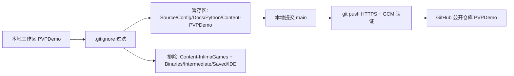

## 用户需求

将本地虚幻引擎项目 `PVPDemo` 发布到 GitHub 上一个新建的**公开仓库**，仓库名为 `PVPDemo`。

## 核心功能

- **内容范围**：上传项目自有内容——`Source` 的 C++ 代码、`Config` 配置、`Docs` 文档、`Content/Python` 迁移脚本，以及 `Content/PVPDemo` 下已迁移完成的自有资产（577 个 `PVP_` 前缀 uasset，约 842MB）。
- **排除范围**：第三方资产 `Content/InfimaGames`（Tactical FPS Animations，约 900MB）不上传；`Binaries`、`Intermediate`、`Saved`、`DerivedDataCache` 等构建/缓存产物，以及 `.vs`、`.idea`、`.codebuddy`、`*.sln`、`*.slnx` 等本地 IDE 文件同样排除。
- **版本控制方式**：使用普通 git 提交，不使用 Git LFS；单个文件均小于 GitHub 100MB 限制。
- **仓库创建方式**：用户在 GitHub 网页手动新建公开仓库（不初始化 README / .gitignore / license），提供仓库 URL 后由助手完成初始化、提交与推送。
- **最终效果**：GitHub 仓库主页可浏览完整的源码树与 842MB 资产，仓库总量约 850MB，主分支为 `main`，本地与远端提交一致；仓库中不含任何第三方资产与构建产物。

## 技术栈

- 版本控制：Git 2.50.1（Windows / PowerShell，已安装）
- 远端托管：GitHub（HTTPS 协议 + Git Credential Manager 交互认证）
- 大文件策略：不使用 LFS，改用 `.gitattributes` 标记二进制类型 + `core.bigFileThreshold` 优化打包性能
- 无 gh CLI：远端仓库由用户手动创建，本地仅执行 `git remote add` / `git push`

## 实现方案

在项目根目录初始化本地仓库（分支 `main`），通过 UE 标准 `.gitignore` 精确控制纳入范围：白名单式保留 `Content/PVPDemo`、`Source`、`Config`、`Docs`、`Content/Python`、`*.uproject`、`.vsconfig`，黑名单式排除 `Content/InfimaGames` 与全部生成产物。先暂存并做"推送前体检"（确认第三方资产 0 命中、最大文件 <100MB、总体积符合预期），再关联用户提供的远端 URL 推送。

关键决策与理由：

1. **不使用 LFS**：GitHub 免费 LFS 额度仅 1GB 存储/1GB 月流量，842MB 资产已逼近上限，一旦超限推送会被服务端拒绝；而普通提交下最大单文件约 35MB，远低于 100MB 硬限制，可行且后续 `pull` 无需安装 LFS 客户端。
2. **`.gitattributes` 标记二进制**：`*.uasset` / `*.umap` / `*.pdb` 显式声明 `binary`，避免 Git 对二进制做文本换行转换导致资产损坏或全量差异。
3. **`core.bigFileThreshold 32m`**：让 Git 跳过对大体积不可压缩二进制做 delta 压缩尝试，显著降低 `git add` 阶段 CPU 与内存开销（842MB 资产在本机处理时间可从数十分钟量级降到分钟级）。
4. **`http.postBuffer 524288000`**：默认 1MB 缓冲在推送大包时易触发 HTTP 413 / RPC 失败，提升至 500MB 可一次推完。
5. **先体检后提交**：一旦误提交第三方资产，需 `filter-branch`/`filter-repo` 重写历史并强推，成本极高；因此在 `git add` 之后、`commit` 之前用 `git status` / `git ls-files` 做硬校验。

性能与可靠性：远端首次接收约 850MB 数据，推送耗时取决于上行带宽（10Mbps 约 12 分钟以上），GitHub 侧会有后台 GC，推送结束后数分钟内仓库页面体积统计可能滞后，属正常现象。若中途断开，直接重试 `git push` 即可，Git 会重新打包但不影响已成功的对象。

## 实施要点

- **忽略规则精确性**：`Content/InfimaGames/` 必须写在忽略列表；`Content/PVPDemo/` **不可**被任何通配规则误伤（避免出现 `Content/*` 这类过宽规则）。
- **`*.sln` / `*.slnx` 忽略**：属于 UE 本地生成文件，克隆方通过右键 `Generate Visual Studio project files` 重新生成；`.uproject` 与 `.vsconfig` 必须保留。
- **严禁删除磁盘上的 `.codebuddy`**：仅在 `.gitignore` 中忽略，不做任何文件系统清理。
- **提交身份**：本机全局配置为 `Xishijie <2314313672@qq.com>`，需与 GitHub 账号邮箱核对；若不一致，仅在本仓库设置 `user.email` 为 GitHub 提供的 noreply 地址，以保证提交能关联到账号头像与贡献图。
- **引擎关联**：`PVPDemo.uproject` 的 `EngineAssociation` 是本机引擎 GUID，克隆方打开时需重新指定引擎版本；不修改该字段，仅在 README 中说明。
- **凭据安全**：不要在 remote URL 中内嵌 PAT，使用 Git Credential Manager 弹窗登录，避免令牌被写入 `.git/config` 明文。
- **影响面控制**：全程仅新增版本控制元数据文件，不改动任何 `.uasset`、C++ 源码与 Config 内容。

## 架构设计



## 目录结构

```
d:/UE/Unreal Projects/PVPDemo/
├── .gitignore        # [NEW] UE 专用忽略规则：排除 Binaries/Intermediate/Saved/DerivedDataCache/Build、.vs/.idea/.codebuddy、*.sln/*.slnx/*.suo/*.pdb/*.pyc/__pycache__，以及 Content/InfimaGames、Content/Collections、Content/Developers，确保 Content/PVPDemo 不被误伤
├── .gitattributes    # [NEW] 行尾与二进制策略：* text=auto；*.uasset/*.umap binary；*.uproject/*.ini/*.cpp/*.h/*.cs/*.md text
├── README.md         # [NEW] 极简仓库说明：项目简介、目录结构、已排除第三方资产 InfimaGames 的提示与恢复方式、EngineAssociation 为本地 GUID 的打开说明（不含 License 文件）
└── .git/config       # [GENERATED] 本地仓库配置：remote origin 指向用户提供的 URL、http.postBuffer、core.bigFileThreshold
```

关键配置参考（`.gitignore` 核心规则）：

```
# UE 生成产物
Binaries/
DerivedDataCache/
Intermediate/
Saved/
Build/
.vs/
.idea/
.codebuddy/
*.sln
*.slnx
*.suo
*.sdf
*.VC.db
*.pdb
*.pyc
__pycache__/

# 第三方资产与本地编辑器数据（不上传）
Content/InfimaGames/
Content/Collections/
Content/Developers/
```