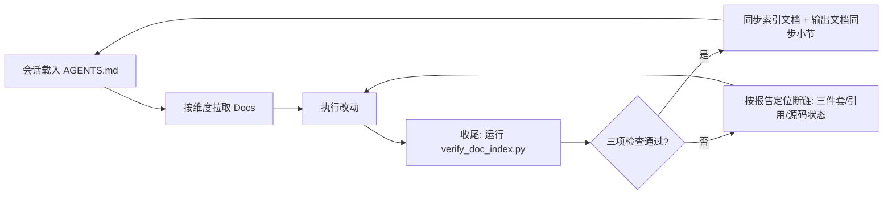

## 产品概述

对 PVPDemo 项目自建的"提示词工程"（`AGENTS.md` + `.codebuddy/rules/doc-first/RULE.mdc` + `Docs/` 三层上下文体系）做一致性修复与加固。上一轮诊断已确认：注入与按需拉取机制有效，但自维护闭环在最近一次 Animation 模块变更中断裂。本方案落实用户确认的全部四项措施，让断裂的闭环恢复，并用机械校验替代纯自觉维护，防止再次腐烂。

## 核心功能

- 补齐 Animation 模块缺失的第三件套 `Animation-Integration.md`，修复 README 中的断链引用；并把 `AGENTS.md`、`Docs/Source-Structure.md` 中 Animation 的"空/预留"状态改为"已实现（可编译、当前未接线）"。
- 精简常驻规则 `RULE.mdc`，删除复制自 `AGENTS.md` 的硬约束速查段，使其回归"只做导航、不承载规范正文"的单一职责，消除双份维护漂移。
- 新增纯 Python 校验脚本 `verify_doc_index.py`，机械检查三件事：各模块三件套齐全、文档中引用的 Markdown 文件真实存在、源码各层空/非空状态与结构文档文首一致；并接入收尾流程，让"文档同步"可被验证。
- 在上下文工程改造计划中追加变更说明，解释保留 always 规则与精简其职责的理由，标注对原计划"不改 plans 目录"的显式偏离。
- 全程保持 UE 阶段约束不变：本方案仅改文档与新增独立校验脚本，不动 C++ 与 `.uasset`，Animation 的"未接线"现状如实保留。

## 技术栈选择

- 文档层：Markdown（`AGENTS.md`、`Docs/*.md`、`.codebuddy/rules/doc-first/RULE.mdc`、`.codebuddy/plans/*.md`），遵循项目既有文档地图与模块三件套制度。
- 校验脚本：Python 3 标准库（`os` / `re` / `json` / `sys`），**不依赖 `unreal` 模块**，可用系统 Python 直接运行，便于本地与 CI 自检；报告落盘格式沿用现有 `verify_pvp_game_framework.py` 的 `check/log` 与失败非零退出约定。

## 实现方案

策略：先用第一方事实（源码与磁盘）补齐文档断链，再把维护规则从"靠 AI 自觉"升级为"脚本可验证的闭环"。关键决策与理由如下。

1. **Animation 三件套补齐**：以 `Docs/Input/Input-Integration.md` 的固定 8 章节为骨架，以 `Docs/Animation/README.md`（变量权威表、接线状态）与 `Animation-Dev.md`（源码结构、Build.cs 未改、未接线说明）为内容来源编写 `Animation-Integration.md`，不臆造接口；文首元信息按 `AI-Workflow.md` 6.2 固定六项填写，`最后更新` 为 2026-11-23。新建后 README 文首"配套文档"与路由表中的引用自动变为可达，断链消除。
2. **状态索引同步**：`AGENTS.md` 第 1 节项目速览把 `Animation/` 从"规划中的空目录"移入"已落地"清单并标注"可编译、未接线"；第 2.1 节模块文档目录表新增 Animation 行（含三件套路由）；文档地图中 `Content/Python/` 工具行登记 `verify_doc_index.py`、`Saved/` 产物行登记 `Saved/DocIndexReport/`。`Docs/Source-Structure.md` 文首"当前状态/阶段说明"与第 1 节目录树把 Animation 行由"空"改为"已有 `PVPAnimInstanceBase.h/.cpp`"，目录树行尾状态标注保持规整（供校验脚本解析）。
3. **RULE.mdc 减法**：删除第 2 节"硬约束速查"5 条（正文唯一来源为 `AGENTS.md` 第 4 节），保留第 1 节导航协议、第 3 节收尾、第 4 节兜底；在第 3 节收尾补一句"结构性改动后运行 `verify_doc_index.py`"，使规则真正只导航且不重复规范正文。
4. **校验脚本 `verify_doc_index.py`**：从 `__file__` 上溯三级定位项目根（无需 UE 环境），执行三项硬校验并写报告到 `Saved/DocIndexReport/verify.{json,md}`，失败即非零退出：

- 三件套完整性：遍历 `Docs/` 下各模块目录，必须同时含 `README.md`、模块名`-Dev.md`、模块名`-Integration.md`。
- 文档引用可达性：扫描 `Docs/` 全部 Markdown 中反引号包裹的 `.md` 路径引用，解析为项目根相对路径并验证存在（当前 Animation 断链修复后应全部通过）。
- 源码状态一致性：扫描 `Source/PVPDemo/` 各分层目录有无 `.h/.cpp` 得到实际空/非空集合；解析 `Source-Structure.md` 第 1 节目录树各层行的"空/已有"标注得到文档声明集合；两者比对，差异即失败。

5. **流程接入**：在 `Docs/AI-Workflow.md` 收尾/输出要求处追加一条：结构性改动（新增/删除/重命名模块、文档、脚本）后运行 `verify_doc_index.py`，全绿方可收尾，并纳入"文档同步"小节说明。
6. **计划回写**：在 `agents-md-context-engineering_a8b4c8aa.md` 末尾追加"后续变更说明"：记录保留 `RULE.mdc`（`alwaysApply: true`）以防新会话漏读 `AGENTS.md`、并将其瘦身为纯导航的决策；显式标注偏离原"实施要点"中"不改 `.codebuddy/plans/`"一条，理由为用户明确要求回写。

## 实现要点

- 性能可忽略：三项检查均为小体量文件系统与文本扫描（数十个 Markdown、有限源码目录），时间复杂度约 O(文档与源码文件总数)，无 N+1 或网络 I/O；无需缓存。
- 复用而非新建：Integration 文档复用 Input 模块模板与 Animation 现有文档事实；脚本复用现有 `check()/log()` 报告模式，仅替换路径定位方式（去掉 `unreal.Paths`）。
-  blast radius 控制：仅改 5~6 份文档 + 1 个独立脚本；不引入新依赖、不改 `Build.cs`、不改 C++/资产、不创建 `CODEBUDDY.md`（保持 `AGENTS.md` 自动加载）。
- 验证闭环：最后运行 `verify_doc_index.py`，三项检查全绿且报告无 FAIL 才算完成；如仍失败，按报告标签定位对应断链修复后再跑。

## 架构设计

修复后的上下文自维护闭环与校验脚本插入点：



组件关系：`AGENTS.md`（L0 索引与硬约束，唯一权威）→ `Docs/`（L1 各维度正文，模块三件套）→ `RULE.mdc`（常驻导航，零规范正文）→ `verify_doc_index.py`（机械校验，反向守护前两者一致性）。

## 目录结构

```
d:/UE/Unreal Projects/PVPDemo/
├── AGENTS.md                                   # [MODIFY] 第1节项目速览把 Animation 改为已落地(可编译/未接线)；2.1 模块文档表新增 Animation 行；文档地图 Content/Python 行登记 verify_doc_index.py、Saved 行登记 Saved/DocIndexReport/
├── .codebuddy/rules/doc-first/RULE.mdc          # [MODIFY] 删除第2节"硬约束速查"5条，仅留导航/收尾/兜底；收尾节加运行校验脚本提示；保持 alwaysApply:true
├── .codebuddy/plans/agents-md-context-engineering_a8b4c8aa.md  # [MODIFY] 末尾追加"后续变更说明"：保留 always 规则并瘦身理由、显式偏离"不改 plans"条款
├── Docs/Source-Structure.md                    # [MODIFY] 文首"当前状态/阶段说明"与第1节目录树：Animation 由空改为已有 PVPAnimInstanceBase.h/.cpp，行尾状态标注规整化
├── Docs/AI-Workflow.md                         # [MODIFY] 第2/4节收尾要求追加：结构性改动后运行 verify_doc_index.py，全绿方可收尾
├── Docs/Animation/Animation-Integration.md     # [NEW] 第三件套，固定8章节（定位边界/外部依赖/数据流/对外接口/调用方式/禁止依赖方向/变更影响面/相关文件），文首六项元信息，内容取自 README 与 Dev 文档
└── Content/Python/verify_doc_index.py          # [NEW] 纯Python标准库校验：三件套完整性、文档 md 引用可达性、源码层空/非空与 Source-Structure.md 目录树一致；报告写 Saved/DocIndexReport/verify.{json,md}，失败非零退出
```

## 关键代码结构

校验脚本对外契约（接口级，供实现对齐）：

```
# verify_doc_index.py
PROJECT_ROOT = dirname(dirname(dirname(abspath(__file__))))   # 上溯至项目根
MODULES = 自动发现 Docs/ 下一级目录名（Animation/Character/Game/GAS/Input）

def check(label: str, condition: bool, detail: str = "") -> bool: ...
def scan_triad(module: str) -> None: ...          # 检查 README.md、<module>-Dev.md、<module>-Integration.md
def scan_md_refs() -> None: ...                  # 校验 Docs/ 内 .md 路径引用可达
def compare_source_state() -> None: ...          # 源码层空/非空 vs Source-Structure.md 目录树标注
def main() -> None: ...                          # 写报告；任一 FAIL 则 raise SystemExit(1)
```