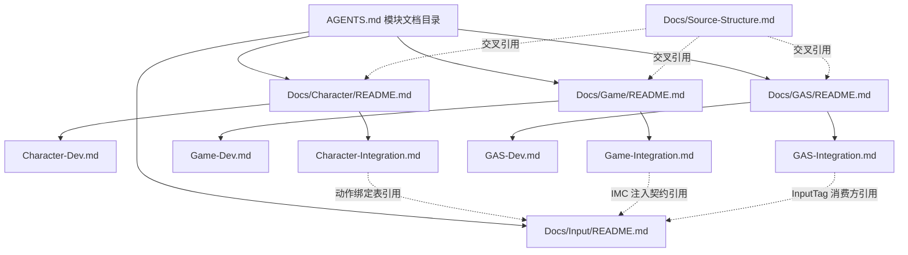

## Product Overview

为已进入实现阶段但缺少模块文档的 Character、Game、GAS 三个功能模块，按项目现行「模块文档制度」补齐固定三件套（导航 / 开发 / 接口），并把新文档登记到全局索引，使任何 AI 或开发者进入这三个模块时都能「先读导航、按场景路由」，不再整目录读源码。

本次只改文档，不涉及源码、资产、配置与脚本改动。

## Core Features

- **Character 模块文档**：记录 1P 角色本体（胶囊与 Mesh 对齐参考蓝图、`CameraFP` 挂 `head` 骨骼且 `bUsePawnControlRotation=true`）、走跑速度切换与 `bIsRunning` 只读契约、原生输入消费方式；明确相机模式栈属于预留阶段，`CameraFP` 当前内置于本模块。
- **Game 模块文档**：记录会话与玩家入口装配（默认 Pawn / PlayerController、`bStartPlayersAsSpectators=false`）、`PlayerController` 的 GameOnly 输入模式、默认 IMC 注入时机与顺序、`OnPossess` 与 `GetPVPCharacter()` 的只读访问契约，以及「Game → Character 单向」边界。
- **GAS 模块文档**：如实记录当前仅有 4 个原生 `InputTag.*` 与 `FNativeGameplayTag` 声明方式，明确 ASC / AttributeSet / GameplayAbility / AbilitySystemGlobals / 双网格 Montage Task / Cue 均未实现，作为后续规划。
- **导航能力**：三份 README 各自提供「模块定位与边界、文档清单与路由、已实现能力速查、启动入口与关键日志、未实现能力、校验入口、维护规则」，场景路由表可直接定位到 Dev / Integration 的具体节号。
- **一致性**：动作与回调的权威表仍只保留在 `Docs/Input/README.md` 第 3 节，新文档只链接不复写；资产总数不复制；踩坑只收录可复现项。
- **全局索引**：`AGENTS.md`「模块文档目录」新增三行，`Docs/Source-Structure.md` 对应三节追加模块文档交叉引用，形成与 `Docs/Input/` 一致的导航闭环。

## Tech Stack

- 文档形态：Markdown，无代码、无资产、无脚本改动；不新增目录层级之外的任何工程结构。
- 规范来源：`Docs/AI-Workflow.md` 第 6 节（三件套触发条件、固定章节、踩坑四要素、读取协议、范例）、`AGENTS.md` 第 4 节硬约束。
- 模板来源：`Docs/Input/README.md`（7 章）、`Docs/Input/Input-Dev.md`（8 章）、`Docs/Input/Input-Integration.md`（8 章），逐节照骨架写，不新造章节。
- 事实来源：已核对的 `Source/PVPDemo/Character/PVPBaseCharacter.h/.cpp`、`Source/PVPDemo/Game/PVPGameMode.*`、`Source/PVPDemo/Game/PVPPlayerController.*`、`Source/PVPDemo/GAS/PVPGameplayTags.*`，以及 `Docs/Source-Structure.md` 2.1 / 2.6 / 2.7、`Docs/Content-Structure.md` 第 4 节、`Content/Python/` 四个相关脚本与 `Saved/` 报告路径。

## Implementation Approach

1. **固定骨架 + 单一事实来源**：每模块先写 README（定义「是什么、有哪些文档、已实现什么」），再写 Dev（「怎么实现、怎么开发、踩过什么坑」），最后写 Integration（「依赖谁、暴露什么、别人怎么调用」）。同一事实只在其中一份定义，另两份用「文档 + 节号」链接。
2. **按模块划清边界，避免内容互相复制**：

- Character README 第 3 节只做「角色能力速查」（组件默认值、相机、移动/跑步状态），4 个动作与 6 条绑定事件的权威表指向 `Docs/Input/README.md` 第 3 节。
- Game README 第 3 节只做「入口装配速查」（默认 Pawn/PC、输入模式、IMC 注入、附身与只读访问），IMC 键位与 Look 极性指向 `Docs/Input/`。
- GAS README 第 3 节只做「原生 Tag 契约速查」（4 个 `InputTag.*` 的语义与消费方），动作绑定指向 `Docs/Input/`。

3. **如实描述阶段状态**：Character 写明 CameraFP 内置与 `Camera/` 模式栈仅预留；GAS 写明无 ASC/GA/AttributeSet，仅有 Tag 定义，`State.*` / `GameplayCue.*` 未定义；Game 写明无 GameState/PlayerState/对局流程。
4. **踩坑真实性**：只收录代码与既有文档能复现的条目（如 InputComponent 类型不符导致绑定跳过、IMC 重复注入导致输入叠加），其余写明「本模块暂无独立踩坑」并链接 `Docs/Input/Input-Dev.md` 对应条；禁止为凑篇幅编造未复现坑点。
5. **索引同步**：`AGENTS.md` 2.1 表新增 Character / Game / GAS 三行（文件夹、导航、开发/接口、现状语义，不写易变数字）；`Docs/Source-Structure.md` 2.1 / 2.6 / 2.7 各追加一行模块文档交叉引用，写法与 2.5 节现有 `> 输入模块文档见 …` 一致。

## Implementation Notes（执行细节）

- **文首元信息逐字对齐**：`维度 / 模块 / 适用工程：PVPDemo（UE 5.9） / 最后更新：2026-11-23 / 上游规范 / 配套文档`，三份互相引用。
- **日志字符串逐字引用**（不得改写）：
- `bound %d/%d native input bindings (config=%s)`、`input component is %s, expected UPVPInputComponent; native bindings skipped.`、`no UPVPInputConfig assigned; native bindings skipped.`、`running=%s max_walk_speed=%.1f`
- `applied %d default input mapping context(s)`、`no default input mapping context applied (IMC asset missing?), input will not work.`、`BeginPlay (GameOnly input mode)`、`OnPossess pawn=%s path=%s`
- `InitGame map=%s options=%s`、`StartPlay default_pawn=%s player_controller=%s`
- **签名与默认值精确**：`CameraFP`（FOV 100、相对旋转 (0,90,-90)、挂 `head`）、胶囊 5 / 88、Mesh 相对变换 (0,0,-88)/(0,-90,0)、`BaseEyeHeight 64` / `CrouchedEyeHeight 32`、`WalkSpeed 300` / `RunSpeed 600`、`DefaultMappingContexts`、`GetPVPCharacter()`（`BlueprintPure`）。
- **易变数字去重**：资产数量只留在 `Docs/Content-Structure.md`；模块文档写语义、路径与契约；仅「4 个原生动作 / 6 条绑定事件 / 4 个原生 Tag」这类行为契约数量允许出现在速查表，并在变动时同轮更新。
- **影响面控制**：不改 `Docs/Input/*`、`Docs/Content-Structure.md`、`Docs/AI-Workflow.md`（制度本身未变）、源码、资产、`Build.cs`；`AGENTS.md` 只动 2.1 表与必要的现状描述，不重写其他章节。
- **链接可解析**：所有「文档 + 节号」引用必须指向真实存在的文件与节标题；避免引用 `Docs/Input/Input-System.md` 等不存在文件（已确认磁盘仅有 `README.md` / `Input-Dev.md` / `Input-Integration.md`）。
- **行数控制**：单份目标 150–260 行，三件套合计不超过 500 行/份的上限约束；超出时按维度拆分并按制度登记。

## Architecture Design

文档导航呈三层结构：全局入口 `AGENTS.md`（模块文档目录）→ 模块导航 `Docs/<模块>/README.md`（能力速查 + 场景路由）→ 开发/接口文档。横向由 `Docs/Source-Structure.md`（源码事实）与 `Docs/Content-Structure.md`（资产事实）提供支撑，`Docs/Input/` 保持动作绑定权威表唯一来源。



## Directory Structure

整体为「新增 3 个模块目录 × 3 份文档 + 修改 2 份索引文档」，不改动任何源码与资产。

```
Docs/
├── Character/                          # [NEW] 角色模块文档目录（与 Source/PVPDemo/Character 同名）
│   ├── README.md                       # [NEW] 导航：定位与边界（含 CameraFP 内置、Camera/ 预留）、文档路由、角色能力速查（组件默认值/相机/移动与跑步状态/输入消费入口）、启动与关键日志（LogPVPBaseCharacter）、未实现能力（3P 双网格、透视切换、网络权威速度）、校验入口（dump_tfa_character.py / compare_tfa_character.py → Saved/PVPCharacterDump/parity_report.md）、维护规则
│   ├── Character-Dev.md                # [NEW] 开发：范围与现状、源码结构（PVPBaseCharacter 构造函数/BeginPlay/SetupPlayerInputComponent/SetRunning）、设计决策（默认值对齐参考蓝图、Controller 拥有视角、Yaw-only 移动基向量、OverrideInputComponentClass）、开发 SOP（改造角色默认值/新增组件的步骤与脚本校验）、踩坑（InputComponent 类型不符、CameraFP 与动画驱动旋转混淆、蓝图覆盖速度需 BeginPlay 重应用）、校验与 PIE 冒烟、已知限制、相关文件
│   └── Character-Integration.md        # [NEW] 接口与依赖：Build.cs 现状（Engine/EnhancedInput 已声明，无新增）、资产契约（BP_PVPBaseCharacter、DA_PVP_InputConfig、SKM/ABP 引用与第三方缺失预期）、数据流（Input → Character → Animation/Camera）、对外接口（CameraFP/InputConfig/WalkSpeed/RunSpeed/bIsRunning）、其他模块调用方式、禁止依赖方向（Character 不感知 Game/）、变更影响面、相关文件
├── Game/                               # [NEW] 会话与入口模块文档目录
│   ├── README.md                       # [NEW] 导航：定位与边界（会话装配与玩家入口，不含角色逻辑）、文档路由、入口速查（DefaultPawnClass/PlayerControllerClass/bStartPlayersAsSpectators/GameOnly 输入模式/IMC 注入/OnPossess/GetPVPCharacter）、启动时序与关键日志（LogPVPGameMode、LogPVPPlayerController）、未实现能力（GameState/PlayerState/对局流程/观战）、校验入口（setup_pvp_game_framework.py / verify_pvp_game_framework.py → Saved/PVPGameFrameworkReport/）、维护规则
│   ├── Game-Dev.md                     # [NEW] 开发：范围与现状、源码结构（PVPGameMode 构造与 InitGame/StartPlay、PlayerController 构造/BeginPlay/SetupInputComponent/OnPossess）、设计决策（不硬编码蓝图路径、IMC 注入放控制器、本地玩家守卫、绑定留在 Pawn）、开发 SOP（替换默认 Pawn/新增控制器能力/重建框架资产）、踩坑（蓝图与控制器重复注入 IMC、无本地玩家时注入被跳过、清空映射导致蓝图上下文失效）、校验与 PIE 冒烟、已知限制、相关文件
│   └── Game-Integration.md             # [NEW] 接口与依赖：Build.cs 依赖、蓝图资产契约（BP_PVPGameMode/BP_PVPPlayerController/L_PVP_Showcase 的 WorldSettings）、数据流与时序（InitGame → StartPlay → Possess → SetupPlayerInputComponent）、对外接口（DefaultMappingContexts、GetPVPCharacter、覆写点）、其他模块调用方式（Input 注入契约指向 Docs/Input/）、禁止依赖方向（Game → Character 单向）、变更影响面、相关文件
└── GAS/                                # [NEW] 技能层模块文档目录（当前仅原生 Tag）
    ├── README.md                       # [NEW] 导航：定位与边界（Tag 命名与语义唯一来源，非 ASC/技能实现）、文档路由、已定义原生 Tag 速查（InputTag.Move/Look/Jump/Run 的语义与消费方，绑定详情链接 Docs/Input/README.md 第 3 节）、启动与关键日志（当前无）、未实现能力（ASC/AttributeSet/GameplayAbility/AbilitySystemGlobals/双网格 Montage Task/GameplayCue）、校验入口（无专用脚本：编译 + 编辑器 GameplayTag 列表 + 引用检查）、维护规则
    ├── GAS-Dev.md                      # [NEW] 开发：范围与现状（仅 PVPGameplayTags）、源码结构（UE_DECLARE/DEFINE_GAMEPLAY_TAG 写法）、设计决策（只定义被消费的 Tag、原生 Tag 优于字符串、Tag 只表达语义不表达按键）、开发 SOP（新增 Tag 的声明/定义/消费方登记顺序）、踩坑（本模块暂无独立踩坑，链接 Input-Dev 踩坑 3 的组件/Cast 相关结论、Tag 字符串与 C++ 符号不一致导致绑定查不到）、校验与冒烟（编译通过 + DA 绑定数 6/6 + 编辑器 Tag 列表可见）、已知限制与路线（ASC 挂 PlayerState、Globals 修正 AllocAbilityActorInfo、双网格 Montage）、相关文件
    └── GAS-Integration.md              # [NEW] 接口与依赖：Build.cs 已含 GameplayTags/GameplayAbilities/GameplayTasks（当前仅用 GameplayTags）、对外接口（PVPGameplayTags::InputTag_* 的 FNativeGameplayTag 类型与导出宏）、其他模块调用方式（UPVPInputConfig 按 Tag 查表、APVPBaseCharacter 按 Tag 绑定）、禁止依赖方向（GAS 不依赖具体相机/动画类）、规划中接口（ASC 宿主、AbilityTask）标注未实现、变更影响面（Tag 重命名需同步 DA 槽位/setup_pvp_input.py/Input 文档）、相关文件
```

**修改文件**

- `AGENTS.md` # [MODIFY] 2.1「模块文档目录」表新增 Character / Game / GAS 三行（文件夹、导航、开发/接口文件名、现状语义描述），保留「预留模块不建目录」说明；不重写其他章节。
- `Docs/Source-Structure.md` # [MODIFY] 2.1 Character、2.6 GAS、2.7 Game 三节各追加一行模块文档交叉引用，格式对齐 2.5 节现有 `> 输入模块文档见 …`。

**明确不改**

- `Docs/Content-Structure.md`（无资产结构变化）、`Docs/AI-Workflow.md`（制度未变）、`Docs/Input/*`（权威表保持唯一来源）、`Source/**`、`Content/**`。